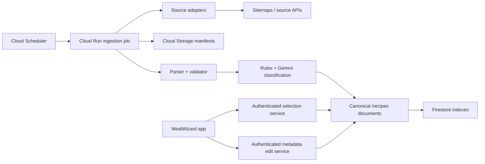

# Unified Recipe Catalogue — Design Specification

**Date:** 2026-07-13
**Status:** Phase 0 verified; Phase 1 catalogue foundation approved to begin
**Scope:** Security hardening, unified complete-recipe ingestion, catalogue-only generation, metadata editing, migration, and managed maintenance

## Context

MealWizard currently discovers recipes through two different paths:

1. Four sites are discovered through sitemaps and stored in `/recipeIndex/{site}/recipes`. A separate scheduled tagger parses and classifies those URLs and also writes full recipe documents into `/recipes`.
2. The remaining trusted sites are searched at generation time through WordPress APIs using a cuisine/meal/ingredient seed. Candidate pages are then fetched, parsed, filtered, and cached in `/recipes`.

This split causes several problems:

- Runtime generation depends on external websites and can be slow or fail transiently.
- Seeded website search can exclude suitable recipes before MealWizard evaluates them.
- A website is prioritized before the application knows whether it contains eligible recipes.
- `array-contains-any` gives OR semantics for tags, while the generator needs strict intersection semantics.
- Search metadata is duplicated between the index and the full recipe cache, so manual edits can leave search and UI state inconsistent.
- The current index, cache, and tagger can use multiple writes for one recipe.
- Maintenance depends on a Windows scheduled task and a logged-in developer machine.
- Client-side paid API credentials and permissive Firestore rules create security and cost risk.

The approved direction is a complete, database-first catalogue. Every recipe must be fully parsed, normalized, classified, and searchable before it can participate in generation. The mobile application must never search or scrape external recipe sites during generation.

## Approved product decisions

1. Store complete normalized recipes during ingestion, not metadata-only stubs.
2. Use a managed Cloud Run Job for ingestion and Cloud Scheduler for triggering it.
3. Use a one-time/daily initial backfill followed by approximately monthly maintenance.
4. Limit ingestion to 18,000 Firestore writes per quota day, leaving approximately 2,000 free-tier writes for normal app activity.
5. Use deterministic canonical-URL IDs so unchanged recipes are skipped before page fetch or write.
6. Search the full eligible catalogue before applying source weights.
7. Make source weights independent of how many recipes a source contains.
8. Never silently relax hard filters or fall back to live scraping.
9. Replace free-text custom instructions with explicit ingredient controls: Must include, Prefer, and Exclude.
10. Store source-derived values separately from manual overrides.
11. Make every tag or time edit atomically update the UI value and searchable fields.
12. Include credential rotation, server-side secrets, hardened Firestore rules, protected household membership, and removal of global cache deletion as mandatory Phase 0.

## Goals

- Fast and predictable generation from Firestore only.
- Strict satisfaction of all selected hard criteria.
- Fair source weighting after global eligibility is established.
- One authoritative recipe document for display and selection.
- Idempotent ingestion with no repeated scraping of unchanged recipes.
- Low or near-zero ongoing infrastructure cost.
- Safe manual correction of tags and times.
- Durable checkpoints, retries, observability, and rollback.
- A migration that preserves existing meal plans and cookbook entries.

## Non-goals

- General web search outside the approved trusted-source list.
- Runtime live-scrape fallback.
- A paid full-text or vector-search service in the first version.
- Free-form semantic instructions that silently become hard requirements.
- Circumventing authentication, paywalls, bot controls, or source access restrictions.
- Republishing recipe content outside the private MealWizard application.
- Broad unrelated UI redesign.

## Architecture



### Component boundaries

#### Source adapters

Each source adapter has one responsibility: expose a consistent discovery and fetch interface for one website.

```ts
interface RecipeSourceAdapter {
  sourceKey: string;
  discover(cursor?: string): AsyncIterable<DiscoveredUrl>;
  canonicalize(url: string): string;
  fetch(url: string): Promise<FetchResult>;
}
```

The existing general Schema.org JSON-LD parser remains shared. Site-specific code is limited to discovery, canonicalization, access configuration, and genuinely necessary normalization.

#### Ingestion job

The Cloud Run Job owns discovery comparison, write budgeting, fetch/parse/classify orchestration, retries, checkpoints, and run summaries. It is the only process that performs bulk catalogue writes.

#### Selection service

An authenticated, scale-to-zero backend endpoint receives a complete generation request, evaluates all hard constraints, applies household weighting, and returns selected canonical recipe IDs. It never fetches recipe websites.

#### Metadata edit service

An authenticated backend mutation validates tag/time edits, stores manual overrides, rebuilds effective values and search fields, and returns the updated canonical document atomically.

#### Mobile app

The app displays canonical Firestore recipes, submits structured generation requests, and observes updated recipe documents. It contains no provider API credentials and performs no runtime recipe scraping.

## Canonical recipe model

The existing root `/recipes` collection becomes the long-term authoritative catalogue. Version 2 documents use a deterministic ID derived from the canonical source URL. Legacy auto-ID documents may coexist temporarily during migration.

Representative schema:

```ts
interface CanonicalRecipe {
  schemaVersion: 2;
  id: string;
  status: 'ready' | 'review' | 'retryable' | 'invalid' | 'disabled';

  source: {
    key: string;
    canonicalUrl: string;
    originalUrl: string;
    sourceLastModified?: string;
  };

  content: {
    title: string;
    imageUrl?: string;
    videoEmbedUrl?: string;
    description?: string;
    originalServings: number;
    ingredients: Ingredient[];
    ingredientGroups?: IngredientGroup[];
    instructions: InstructionStep[];
    notes?: string;
    nutrition?: Nutrition;
  };

  sourceMetadata: {
    prepMinutes?: number;
    cookMinutes?: number;
    totalMinutes?: number;
    mealTypes?: string[];
    cuisines?: string[];
    modifiers?: string[];
  };

  manualOverrides?: {
    prepMinutes?: number | null;
    cookMinutes?: number | null;
    totalMinutes?: number | null;
    mealTypes?: string[] | null;
    cuisines?: string[] | null;
    modifiers?: string[] | null;
  };

  effective: {
    prepMinutes?: number;
    cookMinutes?: number;
    totalMinutes?: number;
    totalTimeProvenance?: 'manual' | 'source' | 'derived';
    mealTypes: string[];
    cuisines: string[];
    modifiers: string[];
  };

  search: {
    selectionKeys: string[];
    vegetarian: boolean;
    kidFriendly: boolean;
    healthy: boolean;
    quick30: boolean;
    moderate45: boolean;
    ingredientTokens: string[];
    randomKey: number;
  };

  classification: {
    parserVersion: number;
    taxonomyVersion: number;
    sources: Record<string, 'source' | 'rule' | 'ai' | 'manual'>;
    complete: boolean;
  };

  ingestion: {
    contentHash: string;
    firstIngestedAt: Timestamp;
    lastChangedAt: Timestamp;
    lastAttemptAt?: Timestamp;
    retryCount?: number;
    nextRetryAt?: Timestamp;
    lastErrorCode?: string;
  };
}
```

Large content fields such as instructions, notes, descriptions, and ingredient groups are exempted from automatic Firestore indexing. Only fields used by selection and operational queries are indexed.

### Readiness invariant

A recipe can have `status == 'ready'` only when:

- Required content validates.
- Effective meal type and time eligibility are known.
- Required taxonomy fields have been classified.
- Search fields match the effective values.
- The document fits Firestore size and index-entry limits.

Generation always queries `schemaVersion == 2` and `status == 'ready'`.

## Metadata editing and index consistency

There is no separately maintained application search document. Display values and searchable fields are stored in the same canonical recipe document. Firestore updates its indexes when that document changes.

Every edit goes through a single metadata mutation:

1. Authenticate the caller and verify edit authorization.
2. Validate the supplied values and controlled tags.
3. Store or clear the requested manual override.
4. Recalculate effective prep, cook, total time, tags, and provenance.
5. Rebuild all dependent search booleans and selection keys.
6. Update metadata version and timestamp.
7. Commit the changes atomically.
8. Return the new canonical recipe.

Time precedence is:

1. Explicit manual total.
2. Source total.
3. Effective prep plus effective cook, marked as derived.

Manual prep and cook values can be edited separately. The UI identifies inferred totals and offers Reset to automatic value for every override.

Example: setting total time to 35 minutes updates `manualOverrides.totalMinutes`, `effective.totalMinutes`, `search.quick30`, and `search.moderate45` in the same write. The recipe detail UI and generation queries therefore cannot disagree.

Ingestion refreshes source fields but never overwrites manual overrides. A taxonomy-version upgrade can reclassify stored content without fetching the source website again.

## Structured generator inputs

The generic Custom cuisine/instruction input is removed from the main flow. Generation uses explicit fields:

- Meal types
- Cuisines
- Maximum duration
- Vegetarian
- Kid friendly
- Healthy
- Salad
- Must include ingredient(s)
- Preferred ingredient(s)
- Excluded ingredient(s)

Semantics:

- Must include is a hard eligibility constraint.
- Exclude is a hard eligibility constraint.
- Prefer affects recipe probability only after hard eligibility.
- Existing ingredient seeds no longer restrict website discovery.
- Existing ingredient weights become post-eligibility preferences.
- No ingredient becomes mandatory unless the user explicitly chooses Must include.

A future Advanced request may translate text into visible structured chips for user confirmation. Unrecognized subjective text remains a soft preference and never silently becomes a hard guarantee.

## Catalogue-only generation

For every requested meal slot:

1. Build the strict constraint set.
2. Query every enabled source with the same indexed predicate.
3. Continue through indexed candidates until the source produces an exact eligible candidate or is proven exhausted.
4. Collect all sources with at least one exact match.
5. Apply household source weights only to those eligible sources.
6. Select one source.
7. Select a randomized exact recipe from that source.
8. Exclude it from the remaining slots in the same generation.

Source probability is:

```text
source weight / sum of weights for sources with exact matches
```

It is independent of the number of recipes held by a source. A disabled source has weight zero and is excluded.

After hard eligibility:

- Preferred ingredients boost probability.
- Starred cookbook recipes may receive a configurable boost.
- Recently used recipes receive a penalty or temporary exclusion.
- Current-plan duplicates are excluded.

Favourites never bypass hard filters.

### Query behavior

Precomputed selection keys represent supported meal-type/cuisine combinations. Fixed modifier and duration fields implement strict AND behavior. The system does not use `array-contains-any` as if it meant all tags.

Ingredient constraints are normalized against ingredient tokens. When a constraint cannot be represented in a single efficient Firestore query, the selection service paginates the indexed categorical matches and evaluates ingredients server-side until it finds a valid recipe or exhausts the source. It does not inspect an arbitrary small prefix and declare a false no-match.

### No-match behavior

If every enabled source is exhausted, the service returns no exact match. It then evaluates controlled one-filter relaxations and reports useful alternatives, for example:

- Eight recipes match if the time limit changes from 30 to 45 minutes.
- Three recipes match if Kid friendly is removed.

The service does not scrape websites, return an incompatible recipe, or relax criteria silently.

## Ingestion and manifests

Each source has a compact Cloud Storage manifest containing known canonical URL hashes, source modification values, permanent-skip state, and the durable processing cursor.

Maintenance flow:

1. Acquire a Firestore lease so only one ingestion execution can run.
2. Load the daily write budget and source checkpoints.
3. Fetch the source sitemap or paginated discovery API.
4. Compare discovery results with the prior manifest.
5. Skip known unchanged URLs without a Firestore read or website fetch.
6. Queue new URLs and genuinely changed entries.
7. Process sources fairly so one large source cannot monopolize the allowance.
8. Save manifests, cursor, budget usage, and run summary.

The manifest is an optimization and checkpoint, not the recipe source of truth. It can be rebuilt from Firestore if lost.

### New recipe processing

1. Canonicalize the URL and derive the deterministic ID.
2. Defensively confirm the document is not already current.
3. Fetch with source-specific concurrency and rate limits.
4. Parse and normalize the complete recipe.
5. Validate required fields, size, and content.
6. Derive objective metadata using source values and deterministic rules.
7. Use structured Gemini classification only for ambiguous descriptors.
8. Build effective metadata and search fields.
9. Write the complete recipe once.
10. Advance the durable checkpoint.

The pipeline classifies before the final write. This replaces the current stub, index-update, and cache-copy pattern with normally one recipe write.

### Repeat-scrape prevention

An existing ready recipe is refreshed only when:

- The source modification value is newer.
- A deliberately long refresh interval has expired.
- The parser version requires extraction from source again.
- A manual force-refresh targets the recipe or source.

A taxonomy-version change uses stored content and does not require a website fetch.

Permanent non-recipe, deleted, or unsupported URLs receive deterministic tombstones. Transient failures receive retry count, next retry time, and exponential backoff.

### Daily write budget

The quota day has a persistent budget document keyed to the Pacific-time reset used by Firestore's daily free quota. The job:

- Reserves at most 18,000 writes for ingestion.
- Counts recipe writes, tombstones, retry updates, budget reservations, and checkpoints.
- Reserves budget in batches to survive restart or repeated same-day invocation.
- Stops before the cap.
- Saves the current cursor.
- Resumes on the next permitted run.

Cloud Run is configured with one task and no overlapping job execution.

### Source responsibility

Source adapters use conservative request rates, honor Retry-After, preserve source attribution and canonical links, and never impersonate another crawler or bypass access controls. Inaccessible authenticated or paywalled content is marked unsupported.

## Failure handling

- Transient network, timeout, 429, and 5xx failures use exponential backoff.
- Permanent 404, validated non-recipe, and unsupported-access outcomes become tombstones.
- A per-source circuit breaker pauses a source when failure rate rises sharply.
- A broken source cannot stop progress on other sources.
- Low-confidence or incomplete classification produces `review`, not `ready`.
- Manifest and Firestore writes are ordered so restart is idempotent.
- Run summaries include discovered, unchanged, fetched, parsed, classified, written, skipped, retried, invalid, and failed counts.
- Repeated job or source failures trigger an alert.

## Phase 0 — security and data-safety foundation

Phase 0 must finish before the new ingestion or selection services are exposed.

### 0.1 Provider credentials

Current paid-provider keys must be treated as compromised because:

- A Gemini key setting is present in committed `eas.json` history.
- Gemini and DeepSeek are read through `EXPO_PUBLIC_*` names.
- Expo replaces `EXPO_PUBLIC_*` references in the client bundle.

Required outcome:

- Old provider keys are revoked after replacement endpoints are verified.
- New provider keys exist only in Google Secret Manager.
- No paid-provider credential exists in tracked files, EAS client variables, app configuration, logs, or the mobile bundle.
- Mobile code calls authenticated MealWizard endpoints.
- Firebase client configuration remains public as intended.

### 0.2 Backend authorization

Backend endpoints require Firebase Authentication and explicit authorization:

- Generation: authenticated household member.
- Recipe metadata edit: authenticated approved editor/admin.
- Household join: authenticated allowlisted user with a valid invite code.
- Ingestion and bulk maintenance: dedicated service account only.

Provider calls have server-side timeouts, rate limits, structured validation, and cost logging.

### 0.3 Firestore rules

Rules must enforce:

- Users can read/write only their own user profile fields permitted by schema.
- Household reads and subcollection access require current membership.
- Only an existing member or trusted backend can change household membership.
- Clients cannot list all households.
- Invite lookup/join occurs through a backend transaction rather than a client collection query.
- Authenticated clients may read ready catalogue recipes needed by the app.
- Clients cannot create, modify, or delete canonical catalogue documents.
- Legacy `/recipeIndex` is client read-only during migration and fully denied after retirement.
- Allowlist behavior does not expose collection enumeration.

Rules are tested with the Firebase Emulator Suite before deployment.

### 0.4 Destructive maintenance removal

Remove the client-side Clear Recipe Cache control and prevent clients from bulk deleting recipes. Replace it with protected, scoped operations:

- Reclassify one recipe.
- Rebuild one recipe's search fields.
- Reparse one recipe or source.
- Disable or re-enable one recipe.
- Run a dry-run catalogue audit.

Missing recipe reads must not automatically delete cookbook or meal-plan history. Orphan handling becomes an explicit migration/repair operation with audit output.

### 0.5 Phase 0 completion gates

- Old keys are revoked.
- New keys are server-only.
- A built app contains no paid-provider key names or values.
- Firestore emulator authorization tests pass.
- Unauthorized recipe writes and household membership changes are denied.
- Global client deletion is absent.
- Existing meal plans and cookbook records survive missing-recipe simulations.
- Server endpoints enforce auth, authorization, quotas, and response validation.

## Migration and rollout

### Phase 0 — security

Complete the security scope above.

### Phase 1 — catalogue foundation

- Add versioned schema and normalization.
- Add source/manual/effective metadata.
- Add atomic search-field rebuilding.
- Add deterministic IDs, manifests, write budget, adapters, selector, and ingestion infrastructure.
- Keep the existing generator behind a feature flag.

### Phase 2 — two-source pilot

Pilot one existing runtime source and one existing indexed source, initially RecipeTin Eats and Serious Eats.

Measure discovery coverage, parse completeness, tag quality, time normalization, duplicate prevention, second-run skip behavior, selection latency, Firestore storage, writes, reads, and Gemini cost.

### Phase 3 — legacy migration

- Export or otherwise back up relevant Firestore data.
- Create deterministic version 2 documents alongside legacy documents.
- Build old-to-new ID mappings.
- Update meal-plan and cookbook references transactionally.
- Verify counts, sample content, and referential integrity.
- Preserve legacy documents.
- Run the new selector in shadow mode.

### Phase 4 — complete backfill

- Run daily under the 18,000-write cap.
- Rotate fairly through all sources.
- Publish source completion and quality summaries.
- Keep incomplete recipes out of generation.

### Phase 5 — cutover

- Enable catalogue-only generation by feature flag.
- Monitor latency, no-match rate, filter correctness, duplicate rate, and weighted source distribution.
- Retain legacy fallback as an operator-controlled rollback only; it is never an automatic runtime fallback.
- Retire runtime search and `/recipeIndex` only after validation.

### Phase 6 — maintenance

- Change from daily backfill to approximately monthly maintenance.
- Retain manual refresh and search-field rebuild operations.
- Alert only on meaningful repeated failures.

## Verification strategy

### Unit tests

- URL canonicalization and deterministic IDs.
- Time parsing and inferred totals.
- Tag taxonomy and provenance.
- Manual override precedence.
- Search-field regeneration.
- Ingredient include/prefer/exclude behavior.
- Strict eligibility intersection.
- Weighted source selection independent of source size.
- Duplicate and recent-use exclusion.
- No-match diagnostics.
- Budget reservation and stop calculations.

### Adapter contract tests

Fixture/snapshot coverage for every source:

- Discovery
- Canonicalization
- JSON-LD extraction
- Ingredients and groups
- Instructions
- Times and servings
- Images/video
- Expected permanent and transient failures

### Firestore emulator integration tests

- Idempotent recipe write.
- Atomic metadata edit.
- Search behavior after tag/time edit.
- Lease and daily budget concurrency.
- Migration reference updates.
- Household membership rules.
- Catalogue read/write rules.
- Unauthorized bulk deletion denial.

### Cloud integration tests

- Small capped pilot ingestion.
- Manifest comparison.
- Unchanged second run with zero recipe fetches and writes.
- Forced termination and cursor resume.
- Circuit breaker and retry behavior.
- Secret access limited to the workload service account.

### Mobile end-to-end tests

- Structured filter entry.
- Generation performs no recipe-site request.
- Every generated recipe satisfies hard filters.
- No-match suggestions.
- Time/tag edit updates the current device and another device.
- Cookbook/calendar continue to resolve migrated recipes.

## Acceptance criteria

- Generation performs no recipe-site requests from the mobile app.
- Every generated recipe satisfies every hard condition.
- All enabled sources are evaluated before source weighting.
- Source selection converges on configured weights independently of catalogue size.
- Manual tag/time edits immediately change UI and eligibility.
- An unchanged maintenance run does not re-scrape or rewrite known recipes.
- Ingestion cannot exceed its configured daily write budget.
- A failed job resumes without duplicate recipe writes.
- Unauthorized users cannot modify catalogue or household membership.
- No client can bulk-delete catalogue recipes.
- Existing cookbook and meal-plan references survive migration.
- The old generator can be restored by feature flag until legacy retirement.

## Observability and cost controls

Track:

- Ingestion duration and per-source throughput.
- Manifest unchanged rate.
- Fetch/parse/classification failure rates.
- Ready/review/invalid counts.
- Writes and reads by run.
- Gemini input/output usage by run.
- Catalogue storage size.
- Generation latency.
- No-match and suggested-relaxation rates.
- Selected source distribution versus configured weights.
- Duplicate/recent-use rejection rates.

Configure billing budgets and alerts. The pilot must establish actual average recipe document size and classification cost before the complete backfill.

## Rollback

- Legacy documents remain until explicit retirement.
- The old generator remains available behind a server-side feature flag during validation.
- Migration records preserve old-to-new mappings.
- No legacy collection is automatically deleted.
- A failed selector deployment can switch back without altering meal plans or cookbook data.
- Ingestion is idempotent and can be paused without invalidating ready catalogue entries.

## High-value follow-up improvements

These are not required for the catalogue cutover unless explicitly added later:

1. Establish a normal automated test/CI command for the broader app.
2. Add regression fixtures for shopping-list normalization, quantities, units, grouping, and substitutions.
3. Expand cookbook search from title-only to title, cuisine, and ingredients.
4. Separate household settings from protected developer/maintenance controls.
5. Replace the starter Expo README with setup, secrets, environments, ingestion, testing, recovery, and release documentation.

## Critical existing files

- `services/generatorService.ts` — current generation and favourite integration
- `services/recipeScraperService.ts` — current runtime orchestration to replace
- `services/scraper/recipeIndex.ts` — current indexed lookup to retire
- `services/scraper/sites.ts` — source configuration and current weighting
- `services/scraper/filters.ts` — deterministic eligibility logic to reuse/refine
- `services/scraper/parse.ts` — shared parser
- `services/scraper/sitemap.ts` — sitemap discovery foundation
- `services/gemini.ts` — client credential/provider calls to move server-side
- `services/deepseek.ts` — client credential/provider calls to move server-side
- `services/firestoreService.ts` — catalogue/settings/household data access
- `services/types.ts` — canonical and request types
- `scripts/buildRecipeIndex.ts` — current discovery script to supersede
- `scripts/tagRecipeIndex.ts` — current tagger to supersede
- `scripts/run-daily-crawl.ps1` — local fallback/reference, not ongoing scheduler
- `components/SettingsModal.tsx` — remove destructive cache maintenance
- `components/RecipeDetailModal.tsx` — metadata editing and live refresh
- `firestore.rules` — mandatory Phase 0 hardening
- `eas.json` — remove paid-provider credentials

## Detailed Phase 0 user runbook

The user-facing runbook is intentionally separated from the implementation plan. Never paste a new provider key into chat, a tracked file, an Expo public variable, an issue, or a build log.

### A. Decide continuity mode

Choose one:

- Security-first: revoke old paid-provider keys immediately. Existing installed builds temporarily lose Gemini/DeepSeek features until backend endpoints are deployed.
- Short staged cutover: create the new server-only keys and backend first, then revoke old keys immediately after the replacement app build is verified. During the short transition, apply provider quotas/budget alerts because the old keys remain exposed.

Security-first is preferred if temporary loss of AI-assisted features is acceptable.

### B. Create a replacement Gemini server key

1. Sign in to Google AI Studio using the owner account for the MealWizard Google Cloud project.
2. Open API key management.
3. Create a new key in the intended project.
4. Do not add it to `eas.json`, an `EXPO_PUBLIC_*` variable, or a local tracked file.
5. Keep the key available only long enough to place it in Secret Manager.
6. Record which old key will be disabled after backend verification.

### C. Create a replacement DeepSeek server key

1. Sign in to the DeepSeek API platform account.
2. Open API key management.
3. Create a replacement key.
4. Do not put it in Expo, `eas.json`, source code, or chat.
5. Record the old key for revocation.

### D. Store replacement keys in Google Secret Manager

1. Open the Google Cloud Console and select the MealWizard project.
2. Enable the Secret Manager API if prompted.
3. Open Secret Manager and choose Create secret.
4. Create `mealwizard-gemini-api-key` with automatic replication and the new Gemini key as version 1.
5. Create `mealwizard-deepseek-api-key` with automatic replication and the new DeepSeek key as version 1.
6. Do not grant public access.
7. Later, grant Secret Manager Secret Accessor only to the dedicated backend workload service account and only for these secrets.
8. Do not grant the mobile Firebase user identities access to the secrets.

### E. Check Expo-hosted variables

1. Open the MealWizard project on expo.dev.
2. Go to Project settings, then Environment variables.
3. Inspect development, preview, and production environments.
4. Delete any Gemini or DeepSeek provider key variables, especially names beginning with `EXPO_PUBLIC_`.
5. Keep normal Firebase client configuration and OAuth client identifiers; those are client configuration, not paid-provider secrets.
6. Do not replace the deleted provider variables with EAS “secret” variables if client JavaScript still reads them. Expo secret visibility does not protect a value that is embedded into the app.

### F. Set spending protection

1. In Google Cloud Billing, create a small monthly budget for the MealWizard project.
2. Add threshold alerts appropriate for expected near-zero usage.
3. In Google API key management, restrict the replacement Gemini key to only the API required by the backend where supported.
4. In the DeepSeek platform, configure available spend/rate limits or usage alerts.
5. Review current usage for both old keys for unexpected activity.

### G. Record deployed-build impact

1. Identify whether any installed development, preview, or production build contains the old keys.
2. Assume every such build exposes them.
3. Plan to distribute a replacement build after the server endpoints and client changes are ready.
4. Remember that removing a key from the repository does not remove it from already-built apps.

### H. Revoke old keys at the cutover gate

1. Verify the new backend endpoints can access both Secret Manager values.
2. Verify the replacement app uses authenticated MealWizard endpoints and contains no provider key.
3. Exercise every AI-assisted feature used by the app.
4. Disable the old Gemini key.
5. Revoke the old DeepSeek key.
6. Monitor errors and provider usage.
7. After the observation window, delete the disabled old Gemini key if desired.

### I. Repository-history handling

The committed old Gemini value remains in Git history. Revoking it is the essential security action. History rewriting is optional after revocation and should be planned separately because it changes commit IDs and disrupts other worktrees/clones.

### J. What Codex can implement after user setup

- Remove paid-provider values from tracked configuration.
- Add server endpoint scaffolding and Secret Manager bindings.
- Replace client provider calls with authenticated endpoint clients.
- Add authentication, authorization, validation, timeouts, and rate limits.
- Harden Firestore rules and add emulator tests.
- Move household joining/membership mutation server-side.
- Remove global cache deletion and automatic orphan deletion.
- Add build scans that fail if paid-provider key names or likely secret patterns enter the client bundle.
- Verify and prepare deployment commands for user approval.
