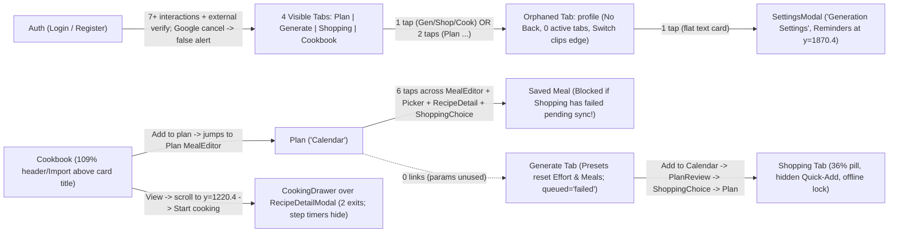

# MealWizard UI/UX & User Flow Audit Report

> [!NOTE]
> **Visually Faithful Front-End Verification & Cross-Flow `/swarm` Audit**: Zero app source files were modified (`git status --short` contains only `M GEMINI.md`). All five user flows were executed end-to-end on the live React Native Web bundle via Playwright Chromium (`390×844` phone viewport, Light & Dark themes, `reducedMotion: 'reduce'`) with the app's actual **`Outfit` (`400`–`700`) fonts** and **`Ionicons.ttf` monochrome vector icon font** loaded (`pageErrors: []`, 22 PNG screenshots, telemetry in `fe_audit_results.json`). All five `/swarm` flow evaluators (`flow-account`, `flow-plan`, `flow-generate`, `flow-shopping`, `flow-cookbook`) and `ux-architect` re-evaluated their conclusions against the real screenshots and [GEMINI.md](../GEMINI.md) backend guardrails.

---

## 1. Audit Methodology, Interaction Counting Rules & Rubric

### Verification Environment & What Changed With Real `Outfit` + `Ionicons`
- **Viewport & Runtime**: `390×844` mobile Chromium viewport running React Native Web (`fe_audit_runner.mjs`) serving `@expo-google-fonts/outfit` (`400Regular`, `500Medium`, `600SemiBold`, `700Bold`) and `@expo/vector-icons` (`Ionicons.ttf` + `Ionicons.json`) alongside mocked Firebase/Auth/Expo native bridges.
- **Visual Delta vs. Fallback Run**:
  - **Improved clarity**: Headings, calendar cards, macro chips, cooking timer pills, `SettingsModal` steppers (`remove-circle-outline` / `add-circle-outline`), and the bottom tab bar (`calendar`, `sparkles`, `cart`, `book` outline → filled emerald `#047857`) match native styling cleanly.
  - **Newly exposed layout & typography defects**: Real `Outfit` metrics exposed `Outfit` weight/fallback drift on screens that specify `fontWeight` without `fontFamily` ([login.tsx](../app/login.tsx), [TabLayout](../app/(tabs)/_layout.tsx#L38), `ErrorBoundary` in [app/_layout.tsx](../app/_layout.tsx#L115-L119), and [AppInviteCard.tsx](../components/AppInviteCard.tsx)), plus `FontWeights.extrabold` (`'800'` in [constants/theme.ts](../constants/theme.ts#L151)) with no loaded `800ExtraBold` face. Wider `Outfit_600SemiBold` labels also worsened wrapping/truncation on Shopping cards (`allSelectedCount: 5`, 100% pill truncation) and pushed Cookbook (`y = 924`) and `"Start cooking"` (`y = 1220.41`) further below the fold, while revealing right-edge clipping on `Profile`'s `"Switch"` button and borderless white-on-white `secondary` action pills.
- **Web vs. Native Divergences**:
  - [ShoppingChoice.tsx](../components/connected/ShoppingChoice.tsx) renders an in-app bottom `Sheet` on Web, whereas native renders a blocking OS `Alert` from inside [ConnectedContext.tsx](../contexts/ConnectedContext.tsx#L157-L180).
  - [login.tsx](../app/login.tsx) and [register.tsx](../app/register.tsx) invoke `Alert.alert`, and native phones lose an extra ~80px vertically to status-bar / home-indicator safe-area insets.

### Tap & Interaction Counting Rules
- **`1 tap`**: One deliberate button, pill, toggle, list row, checkbox, card, tab, or alert/sheet CTA press (`long-press` flagged separately as a hidden gesture).
- **`1 field`**: Focusing and typing into one text input (`external` OS email handoffs always listed separately).
- **`+scroll`**: Scrolling >1 screen height (`>844px`) needed to reach a primary CTA or control.

### Scorecard Rubric
- **Solid**: Zero blocking bugs; clear visual hierarchy in Light & Dark modes; minimal clicks matched to task frequency.
- **Mixed**: Core happy path completes, but imposes unnecessary hops, buried CTAs, or minor visual friction.
- **Needs Work**: Major dark/light contrast defects, misleading status UI, missing affordances, or high-frequency workflow drag.
- **Critical Friction**: Active user dead-ends, cross-screen state deadlocks, or false failure states blocking recurring weekly tasks.

---

## 2. Executive Summary & UX Scorecard

| UX Dimension | Rating | Reconciled `Outfit` + `Ionicons` & Cross-Layer Diagnosis |
|---|---|---|
| **Navigation & Route Soundness** | **Needs Work** | `profile` is trapped inside `(tabs)` (`href: null`): even with real `Ionicons`, **all `0` bottom tabs highlight** (`selectedTabsInBottomBar: 0`) and `ProfileScreen` has **no Back button** (`hasBackButton: false`). Plan (`"Calendar"`) lacks a top-right gear (`hasGearIcon: false`). `GenerateScreen` URL params (`date`, `mealType`, `preset`) remain unwired. `/cook` stacks `CookingDrawer` over `RecipeDetailModal` (`recipeModalStillOpenAfterCookingDone: 1`). |
| **Daily Loop Efficiency (`Frequency × Severity`)** | **Needs Work** | Failed/offline shopping check-offs lock checkboxes (`offlineLockedDisabled: "true"`) AND trigger a **cross-tab planning deadlock** (`failedPendingDeadlockedPlanAdd: true`) while shared `<StatusNotice />` on Plan/Generate hides `p.error`. Clearing purchased items takes `N+2` taps (`Select -> All` hits all `5` items including active/manual rows). Quick-Add hides staples under `'Other'`. Plan manual add takes `6` taps; `PlanReview` opens on `0` conflicts. |
| **Visual Hierarchy & Contrast (Light & Dark)** | **Critical Friction** | **Dark Mode**: `Colors.dark.primary` (`#047857`) on `Colors.dark.primaryLight` (`#064E3B`) breaks readability on Shopping `recipePill`s and Profile `Copy`/`Share`/`Dark`; `PastelCard` leaks bright light blue `#DBEAFE` (`GenerationForm.tsx:109`) + `#D1D5DB` borders; Profile `"Switch"` clips off the `390px` right edge. **Light Mode**: `#F5F5F4` borders vanish inside `#FFFFFF` cards; white `secondary` pills (`Keep/Swap/Remove/Retry`, `Replace ...`) lose all button boundaries inside white cards; `Add meal` stacks **4 colliding `#047857` green pills**; `"Generate"` clips `CUISINES` row 2; `"Forgot password?"` (`y=820`) clips at bottom; Cookbook cards start at `y=924`; `"Start cooking"` sits at `y=1220.41`. |
| **Backend Contract & Architecture Alignment** | **Mixed** | Backend Zod validates `draftSlot.status` as `z.enum(["ready","unmatched","failed"])` ([service.ts](../functions/src/connected/service.ts), [model.ts](../functions/src/connected/model.ts#L109)), causing waiting slots to print **`"failed"`** (`queuedFailedVisible: 5`). `ShoppingChoice` lives inside generic `ConnectedContext.run()`. `DeveloperModeContext` globally patches `console.*` every 100 ms yet drives zero UI. |

---

## 3. End-to-End Flow Graph & Interaction Count Matrix

| User Journey | Weekly Freq | Measured Current Effort | Observed Primary Bottleneck | Target Effort (After Fixes) |
|---|---|---|---|---|
| **Shopping: In-Store Check-Off & Error Recovery** | Multiple / wk | 1 tap (locks offline; **blocks Plan on failure**) | Locked pending checkbox + unnarrowed `pendingRef.current` lockout + `StatusNotice` hiding `p.error` | **1 tap** + instant unsent offline undo; scoped concurrency guard |
| **Shopping: Clear Purchased Items** | 1–2× / wk | **`N + 2` taps** (`Select -> All` selects all `5` incl. active!) | No `"Clear purchased"`; `Remove` lacks confirm dialog | **1–2 taps** (`Clear purchased` + confirm; Decision 2 Approved) |
| **Shopping: Quick-Add / Manual Custom Item** | 2–5× / wk | **4+ taps** (`Other` = 0 chips; **Undo = 0 on manual**) | Defaults to `'Other'`; `saveManual` sets `id: ''` (`undoButtonCountAfterManual: 0`) | **2 taps** (default staples) + working **1-tap Undo** |
| **Cooking: Active Timers & Completion Exit** | 3–7× / wk | Scroll to `y=1220.4` + **timer hides Step 2→3** + **2 exits** | `CookingDrawer` filters `!t.recipeId` (`L325`); stacked `<Modal>` over `RecipeDetailModal` | Sticky `"Start cooking"` + pinned header timers + **1 exit** on `/cook` (Decision 3) |
| **AI Plan Generation → Confirm → Shopping** | 1–2× / wk | **2 taps** default / **9+ taps** custom + `PlanReview` + `ShoppingChoice` | Presets wipe Effort/Meals (`beforePreset->afterPreset`); queued `"failed"`; `0` Swap Apply; unconditional `PlanReview` | **2–5 taps** + inline toggle on conflicts + `View Shopping` CTA (Decision 1) |
| **Manual Meal Add on Plan (`+` → Saved Recipe)** | 3–5× / wk | **6 taps** (`manualAddClicks: 6`) across 4 sheets | `MealEditor` (4 green pills) + forced preview + `ShoppingChoice` | **2–3 taps** (`RecipePickerModal` direct `Use` + silent `'keep'`, Decision 1) |
| **Cookbook URL Import → Save to Cookbook** | 1–2× / mo | **4 taps + 1 field** (close modal to tap card Save) | `RecipeDetailModal` `actionBar` omits `"Save to cookbook"` (`hasSaveInModalActionBar: 0`) | **3 taps + 1 field** (`+ Import` sheet + Save inside modal, Decision 3) |
| **Email Sign-Up → Verified Household** | Once | **7+ steps** + `external verify` (`+7` on mistyped invite) | Verification gate (`passwordOnboarding`), late invite validation, `RootNavigator` modal race | **5 steps** + `external verify` (keep gate; validate invite pre-signup; prefill email) |

---

## 4. Visual & Functional Flow Verification (`390×844` Light & Dark · `Outfit` + `Ionicons`)

### Flow 1 — Auth, Profile Shell, Settings & Reminders

> **Visual Captures (`390×844` · `Outfit` + `Ionicons`)**:
> - `fe_login_light.png` — Login Screen Light (Outfit + Ionicons): Crisp icons inside card, Forgot password clipped at y=820, faint #F5F5F4 borders
> - `fe_profile_light.png` — Profile Light (Outfit + Ionicons): 0 active tabs, no Back button, edge-to-edge Admin Invite pushes QATEST to y=555
> - `fe_profile_dark.png` — Profile Dark (Outfit + Ionicons): Dark green text on dark emerald Copy/Share/Dark pills; Switch button clipped on right edge
> - `fe_settings_modal_light.png` — Settings Modal Light (Outfit + Ionicons): Crisp circular -/+ steppers and Outfit type; Meal Reminders pushed down to y=1870.4

1. **Login & Registration (`fe_login_light.png`, `#23`)**:
   - **Typography & Borders**: Vector icons inside the Harvest emblem, Email, Password, eye toggle, and Google button now render cleanly, exposing **system-font fallback** on `"Continue with Google"` / `"Forgot password?"` (`login.tsx` omits `fontFamily: Fonts.*`) and **near-invisible field borders** (`inputBorderColor: "rgb(245, 245, 244)"` on `"rgb(253, 251, 247)"`), with input icons touching placeholder text (`your@email.com`, `Enter your password`).
   - **Below-Fold Clipping & Bugs**: `"Forgot password?"` (`forgotPasswordY: 820`, `googleBtnY: 719.5`) clips across the very bottom edge of `844px`, pushing `"Create Account"` off-screen. Register's password eye toggle measures **`36×36px`**, Google cancel shows a false `"Sign-In Failed"` (`googleCancelShowsFalseFailure: true`, missing `.code` in [AuthContext.tsx](../contexts/AuthContext.tsx#L287)), `showInviteModal` in `register.tsx` is dead code, `pendingInviteCode` races `RootNavigator` ([app/_layout.tsx](../app/_layout.tsx#L52-L56)), and `user && !householdId` lacks a recovery route. Keep the `passwordOnboarding` email-verification gate (`GEMINI.md`); validate invite codes before signup and pre-fill email on `/login`.

2. **Profile & Settings (`fe_profile_light.png`, `fe_profile_dark.png`, `fe_settings_modal_light.png`, `#23`)**:
   - **Orphaned Navigation & Dark Mode Clipping**: With real monochrome `Ionicons`, `fe_profile_dark.png` makes it unmistakable that **all 4 bottom tabs are inactive gray** (`selectedTabsInBottomBar: 0`) with **`hasBackButton: false`**. `Copy`, `Share`, and selected `Dark` render low-contrast dark-green ink `#047857` on `#064E3B`, while `joinInput` (`flex: 1` without `minWidth: 0`) **clips the right edge of `"Switch"` off the `390px` viewport** (and empty `"Switch"` remains bright green `emptySwitchOpacity: "1"` with zero confirmation alert when leaving a household).
   - **Layout & Dead Toggle**: Full-bleed [AppInviteCard.tsx](../components/AppInviteCard.tsx) lacks horizontal margins and pushes `"YOUR HOUSEHOLD CODE"` down (`codeY: 555`). `"Household preferences and reminders"` lacks an icon/chevron. **Remove** the dead `Developer Mode` switch & [DeveloperModeContext.tsx](../contexts/DeveloperModeContext.tsx) (`GEMINI.md`).
   - **Settings Density**: Titled `"Generation Settings"`, expanding targets pushes `"Meal Reminders"` down to **`remindersOffsetTop: 1870.43px`**; `weightChipRect` is `131.67×33px`, `addTermRect` is `40×40px`, `TimePickerModal` lists `60` minutes (`timePickerItemCount: 60`) with `getItemLayout` height mismatch (`48` vs `44`), and closing `X` discards unsaved edits silently.

---

### Flow 2 — Weekly Plan Calendar & Manual Meal Entry

> **Visual Captures (`390×844` · `Outfit` + `Ionicons`)**:
> - `fe_plan_week_light.png` — Plan Week Light (Outfit + Ionicons): Filled green Plan tab & crisp calendar badges; header reads Calendar without gear; footer macros lack Per serving
> - `fe_plan_week_dark.png` — Plan Week Dark (Outfit + Ionicons): Readable dark surfaces and badges; narrow card wraps titles to 4 lines and shows no direct Cook CTA
> - `fe_plan_meal_editor_light.png` — Plan Meal Editor Light (Outfit + Ionicons): Four solid green #047857 buttons compete (dinner + two 'Choose recipe' pills + 'Save meal') while Cancel is pushed off-screen
> - `fe_plan_picker_preview_light.png` — Plan Picker Preview & ShoppingChoice Light (Outfit + Ionicons): Mandatory preview exposes live ... and ☆ icons; Save triggers ShoppingChoice over sliced Add meal
> - `fe_plan_shopping_choice_light.png` — Plan ShoppingChoice Light: Stacked Update shopping list modal inside ConnectedContext.run()

1. **Calendar Header, Density & Macros (`fe_plan_week_light.png`, `fe_plan_week_dark.png`, `#22`)**:
   - Real `Outfit` + `Ionicons` look clean on both themes, confirming the `"Plan"` tab vs. **`"Calendar"`** header mismatch (`hasGearIcon: false`, `hasOptionsDots: true`). Narrow day cards wrap `"Lemon Herb Roast Chicken with Crispy Potatoes"` to 4 lines and attached side `+ Garlic Herbed Rice Pilaf` to 2 lines, hide `"Dinner"` behind a `🌙` icon, mix non-interactive `"Complete all nutrition target slots in Settings."` copy with **`hasPerServingLabel: false`** macro footer chips, and preserve no `adults`/`children` split on save (`normaliseMeal` in `PlanScreen.tsx`).

2. **4-Green-Pill `MealEditor` Collision & 6-Tap Manual Add (`fe_plan_meal_editor_light.png`, `fe_plan_shopping_choice_light.png`, `#22`)**:
   - `Add meal` renders **4 indistinguishable `#047857` green pills** (`dinner`, mode toggle `Choose recipe`, picker button `Choose recipe`, and `Save meal`) while pushing `Cancel` below the sheet fold.
   - Manual add takes **`6` taps** through 4 stacked sheets (`+` → `"Choose recipe"` → candidate row → mandatory `"Use recipe"` preview in `fe_plan_picker_preview_light.png`, which also leaks `...`/`☆` mutators → `"Save meal"` → `"Keep existing items"` inside `ShoppingChoice` injected by `ConnectedContext.run()`).

---

### Flow 3 — AI Plan Generation, Draft Status, Substitutions & Review

> **Visual Captures (`390×844` · `Outfit` + `Ionicons`)**:
> - `fe_generate_form_light.png` — Generate Form Light (Outfit + Ionicons): Sticky Generate button slices through CUISINES row 2; Plan Details and Presets sit below 844px fold
> - `fe_generate_form_dark.png` — Generate Form Dark (Outfit + Ionicons): Any cuisine leaks bright pastel light blue #DBEAFE against charcoal cards with harsh #D1D5DB borders
> - `fe_generate_draft_failed_light.png` — Draft Generation Light (Outfit + Ionicons): Waiting slots show 'Ready to generate' with 'failed' underneath; secondary card buttons look like floating grey text
> - `fe_generate_substitution_deadend_light.png` — Generate Substitution & PlanReview Light: SubstitutionDrawer ends with blank space below rationale (0 Apply CTA)
> - `fe_generate_plan_review_light.png` — Generate PlanReview Light: Raw ISO dates and lowercase 'dinner'; white Replace button has no visible border inside white card

1. **Generate Form Visuals & Preset Reset (`fe_generate_form_light.png`, `fe_generate_form_dark.png`, `#24`)**:
   - Floating `"Generate"` (`floatingAction`) overlays the second row of `CUISINES` with no background fade/spacer while `Plan Details`, `Presets`, Dates, Days, and Meals sit below the fold. In Dark Mode, selected `"Any cuisine"` hardcodes `Colors.light[bg]` (`#DBEAFE` with black ink in [GenerationForm.tsx](../components/connected/GenerationForm.tsx#L109)), and `PastelCard` uses bright `#D1D5DB` borders.
   - **Preset Wipes Proven in DOM Telemetry**: Selecting `Up to 45 min` + `Breakfast` (`beforePreset: { min45Selected: true, breakfastSelected: true }`) then tapping `5 dinners` resets both (`afterPreset: { min45Selected: false, min30Selected: true, breakfastSelected: false }`).

2. **Queued `"failed"`, Invisible Secondary Buttons & Substitution Dead-End (`fe_generate_draft_failed_light.png`–`fe_generate_plan_review_light.png`, `#24`)**:
   - All `5` waiting slots show **`"failed"`** (`queuedFailedVisible: 5`). Per `GEMINI.md` and backend Zod validation (`z.enum(["ready","unmatched","failed"])` in `service.ts` / `model.ts`), fix [DraftRecipeCard.tsx](../components/connected/DraftRecipeCard.tsx#L104) to render `"Waiting in queue…"` / `slot.message` instead of mutating client status to `"pending"`.
   - **Newly Caught Visual Bug**: [ui.tsx](../components/connected/ui.tsx#L91) renders `Button` (`secondary`) and `<Card>` with identical `#FFFFFF` `colors.surface` and `borderWidth: 0`, making `Keep / Swap / Remove / Retry` (`fe_generate_draft_failed_light.png`) and `Replace Creamy Tomato Basil Rigatoni` (`fe_generate_plan_review_light.png`) look like borderless floating text.
   - `SubstitutionDrawer` (`fe_generate_substitution_deadend_light.png`) opens only via hidden `onLongPress` and ends in blank space (`hasApplyButtonInGenerateDraft: 0`), while `GenerateScreen` omits `defaultServings` on draft modals (`Servings: 2`) and triggers a dead `expectedRevision > 0` check ([GenerateScreen.tsx](../components/connected/GenerateScreen.tsx#L649)).

---

### Flow 4 — Shopping List, Quick-Add, Offline Sync & Cross-Tab Deadlock

> **Visual Captures (`390×844` · `Outfit` + `Ionicons`)**:
> - `fe_shopping_list_light.png` — Shopping List Light (Outfit + Ionicons): Wider Outfit labels wrap Crushed Tomatoes and Extra Virgin Olive Oil to 2 lines beside 36% truncated recipe pills; Pantry shows shopping cart icon
> - `fe_shopping_list_dark.png` — Shopping List Dark (Outfit + Ionicons): Dark green pill labels (#047857) on dark emerald fill (#064E3B) fail contrast across every item
> - `fe_shopping_add_sheet_other_light.png` — Shopping Add Sheet Light (Outfit + Ionicons): Defaults to Other (0 Quick-Add chips) with flat-border inputs and washed-out disabled button

1. **Dark-Mode Pill Contrast & `Outfit` Wrapping (`fe_shopping_list_light.png`, `fe_shopping_list_dark.png`, `#26`)**:
   - [ShoppingScreen.tsx](../components/connected/ShoppingScreen.tsx#L101-L133) draws recipe pills in `colors.primary` (`#047857`) on `colors.primaryLight` (`#064E3B`) in Dark Mode—near-illegible dark green on forest green across all items. Meanwhile, `Outfit_600SemiBold` at `17px` forces even 2-word items (`"Crushed\nTomatoes"`, `"Extra Virgin\nOlive Oil"`) onto 2 lines while `36%`-wide (`117.36px` / `326px`) pills truncate **all 4 recipe chips** (`Lemon Herb Ro...`, `Creamy Tomato...`, `Lemon Her... +1 ⌄`). `'Pantry'` falls back to `🛒` at `ShoppingScreen.tsx:144` because the icon map only keys `'Pantry & Dry Goods'`. Items show decimals (`1.5 tbsp`, `usesDecimalAmount: true`).

2. **Cross-Tab Deadlock, Missing Undo & Destructive Select (`fe_shopping_add_sheet_other_light.png`, `#26`)**:
   - **Verified Live Deadlock (`failedPendingDeadlockedPlanAdd: true`)**: A failed shopping check keeps `p.error` inside `pendingRef.current` ([ConnectedContext.tsx](../contexts/ConnectedContext.tsx#L164)), blocking ALL meal additions on Plan/Generate (`"Wait for shopping changes to finish syncing before adding meals."`), while `<StatusNotice />` ([classic.tsx](../components/connected/classic.tsx#L196-L197)) on Plan/Generate only says `"N changes syncing"` without surfacing `p.error` retry/dismiss. Keep the `pendingRef.current` concurrency guard for active writes (`!p.error`) per `GEMINI.md`.
   - Offline check-offs lock rows (`offlineLockedDisabled: "true"`); `"+ Add items"` opens on `'Other'` (`quickAddVisibleOnOther: 0`, `quickAddVisibleOnProduce: 1`); manual entry sets `id: ''` (`undoButtonCountAfterManual: 0`); and `Select -> All` selects all **`allSelectedCount: 5`** items (active + purchased + manual) with zero `"Clear purchased"` action or `Remove` confirmation.

---

### Flow 5 — Cookbook Discovery, Import Preview & Active Cooking Timers

> **Visual Captures (`390×844` · `Outfit` + `Ionicons`)**:
> - `fe_cookbook_above_fold_light.png` — Cookbook Above Fold Light (Outfit + Ionicons): Search, 12 mixed-case filter pills, and expanded Import card consume 109% above first card title (y=924)
> - `fe_cookbook_import_preview_light.png` — Cookbook Import Preview Light (Outfit + Ionicons): Action bar shows Add to plan only — zero Save to cookbook CTA while exposing ... and ☆ mutators
> - `fe_recipe_detail_light.png` — Recipe Detail Light (Outfit + Ionicons): Title truncates to 2 lines beside 32x32 closeBtn; Start cooking buried below fold at y=1220.4
> - `fe_cooking_timer_step2_light.png` — Cooking Timer Step 2 Light (Outfit + Ionicons): Crisp Ionicons timer pill (15:00 + refresh) stacked on RecipeDetailModal over Cookbook
> - `fe_cooking_timer_step3_hidden_light.png` — Cooking Timer Step 3 Hidden Light (Outfit + Ionicons): Advancing to Step 3 hides running 15:00 timer; displays '¼ cups lemon juice'

1. **Cookbook Above-Fold Saturation & Unsaved Preview Gap (`fe_cookbook_above_fold_light.png`, `fe_cookbook_import_preview_light.png`, `#25`)**:
   - Search bar + 5 status/time chips + 7 mixed-case course chips (`All meals`, lowercase `breakfast..dessert`) + expanded `"Import a recipe"` card consume **`headerAndImportConsumedPct: 109%`** down to the first card's clickable title (`firstRecipeCardTopY: 924`), leaving only `"3 recipes"` and a yellow border sliver peeking above the tab bar. `"Recipe URL"` white input inside white `#FFFFFF` card has faint borders, and disabled `"Preview import"` (`opacity: 0.45`) washes out.
   - Previewing an imported URL renders **`hasSaveInModalActionBar: 0`** (`"Add to plan"` only) while leaving `...` (Cooking History) and `☆` (Favourite, mutating cookbook state) live in the top bar.

2. **`RecipeDetailModal` Scroll Burial, Touch Targets & Cooking Timers (`fe_recipe_detail_light.png`–`fe_cooking_timer_step3_hidden_light.png`, `#25`)**:
   - Hero, tags, `Remove from cookbook` button competing beside `Add to plan`, 4 macro cards, 3 time chips, `ADULTS`/`CHILDREN` stepper, equipment, and ingredients push `"Start cooking"` to **`startCookingInitialY: 1220.41px`** (`startCookingBelowFold844: true`). `closeBtnRect` (`32×32px`) visibly dwarfs next to `44×44` `...`/`☆`, `stepperBtnRect` is `36×36px`, and long titles truncate to 2 lines (`Lemon Herb Roast\nChicken with ...`).
   - `CookingDrawer` Step 2 shows a crisp `15:00` timer (`timerVisibleOnStep2: 1`) + `↻` inside a ~55%-height drawer stacking **2 dimmed modal layers** underneath; advancing to Step 3 hides the active timer completely (`timerVisibleOnStep3: 0`, [CookingDrawer.tsx](../components/connected/CookingDrawer.tsx#L140)) and displays `"¼ cups lemon juice"` (plural unit). Tapping `"Done"` fails to reset step `0` or close `RecipeDetailModal` (`recipeModalStillOpenAfterCookingDone: 1`). *(Cookbook/Cooking captures are Light Mode only.)*

---

## 5. Prioritized Three-Track Global Roadmap (`Frequency × Severity`)

Organized per [GEMINI.md](../GEMINI.md) into **Correctness Bugs**, **Flow & Architecture Changes** *(incorporating User-Approved Decisions 1–3)*, and **Design System & Polish**, ranked strictly by **Weekly Frequency × Severity**.

### Track 1 — Correctness Bugs *(1 Issue per Ticket · Automated Regression Test Each)*

| Priority (`Freq × Sev`) | Ticket & Exact Fix | Guardrail / Test Requirement |
|---|---|---|
| **T1-1 (Critical · Daily/Weekly)** | **Fix cross-tab failed-pending deadlock & `StatusNotice` error blindness** ([ConnectedContext.tsx](../contexts/ConnectedContext.tsx#L164), [classic.tsx](../components/connected/classic.tsx#L196-L197)): Exclude `p.error` items from blocking meal writes (`pendingRef.current.some(p => !p.error)`) and render `p.error` Retry/Dismiss directly inside shared `<StatusNotice />`. | Preserves active `expectedRevision`/`generation` guard (`service.ts`). Unit test: errored queue item permits `addMeal` while active non-errored item still guards. |
| **T1-2 (Critical · Weekly)** | **Enable local offline undo for unsent queued checks** ([ShoppingScreen.tsx](../components/connected/ShoppingScreen.tsx#L112), `ConnectedContext.tsx`): Coalesce/cancel only unsent, non-errored queued checks (`acknowledgedRevision === undefined && !error`) offline while locking in-flight RPCs until observed. | Preserves concurrency safety once dispatched. Unit test: offline toggle check→uncheck cancels local delta cleanly. |
| **T1-3 (High · Weekly)** | **Fix cross-step timer disappearance, abbreviations & `"Done"` reset** ([CookingDrawer.tsx](../components/connected/CookingDrawer.tsx#L140), `services/cookingSession.ts`, [app/cook.tsx](../app/cook.tsx#L36-L52)): Display active `recipeId === id` timers persistently across steps, parse `min`/`mins`/`hr`/`hrs`/`sec`, reset `session.steps[id] = 0` on `"Done"`, and exit `/cook` in 1 tap. | Tests: Step 2 timer stays visible on Step 3; regex parses abbreviations; `"Done"` resets step to `0`. |
| **T1-4 (High · Weekly)** | **Fix manual Shopping `"Undo"` (`id: ''`), `'Pantry'` lookup & bulk `Remove` confirm** ([ShoppingScreen.tsx](../components/connected/ShoppingScreen.tsx#L19-L20)): Pass created/temp `id` into `saveManual` `setLastAdded`, map `'Pantry'` → `'Pantry & Dry Goods'`, require Alert confirm before bulk `Remove`, and pass `mealPlanEntry` in `openRecipe`. | Tests: manual add renders working Undo pill; Pantry displays correct emoji/sort; `openRecipe` keeps meal overrides. |
| **T1-5 (High · Weekly)** | **Fix queued `"failed"` label, preset reset, leftover un-allocate & dead `expectedRevision > 0` check** ([DraftRecipeCard.tsx](../components/connected/DraftRecipeCard.tsx#L104), [GenerateScreen.tsx](../components/connected/GenerateScreen.tsx#L346-L362)): Render `slot.message` (`"Waiting in queue…"`) on unattempted slots, preserve user `minutes`/`types` in `preset()`, allow clearing `sourceMealId`, and check `hasMeal(...)` instead of `expectedRevision > 0`. | Keep `z.enum(["ready","unmatched","failed"])` in `service.ts`/`model.ts` unless coordinated schema deployment. Unit tests for each fix. |
| **T1-6 (High · Weekly)** | **Add `"Save to cookbook"` on preview, gate preview mutators & preserve `adults`/`children`/`servings`** ([CookbookScreen.tsx](../components/connected/CookbookScreen.tsx#L221-L260), [RecipeDetailModal.tsx](../components/RecipeDetailModal.tsx#L699-L735), [PlanScreen.tsx](../components/connected/PlanScreen.tsx#L319), [app/cook.tsx](../app/cook.tsx#L44-L49), `utils/ingredientFormat.ts`, `services/stepIngredients.ts`): Add modal Save when `!inCookbook`, suppress live mutators in preview/picker, pass servings metadata cleanly, guard `closeSheet` double-fire (`closing.current`), fix `"¼ cup"` pluralization & shared head-noun ingredient matching, and handle `duration === 0` intentionally in `filterCookbook`. | Unit & component tests verifying each preservation, guard, and formatting rule. |
| **T1-7 (High · Weekly)** | **Prevent `SubstitutionDrawer` dead-end & pass `defaultServings` in Generate** (`SubstitutionDrawer.tsx`, [GenerateScreen.tsx](../components/connected/GenerateScreen.tsx#L699-L703)): Pass `defaultServings={slot.servings}` and show explicit guidance (`"Add meal to calendar to apply swaps"`) / disable swap affordance cleanly when `meal === undefined`. | Test: `!meal` never renders silent blank dead-end below rationale. |
| **T1-8 (High · Every Dark Session)** | **Fix Dark-Mode `primary`-on-`primaryLight` contrast, `PastelCard` light leak & Profile `"Switch"` clipping** ([constants/theme.ts](../constants/theme.ts#L70-L71), [GenerationForm.tsx](../components/connected/GenerationForm.tsx#L109), `PastelCard.tsx`, `app/(tabs)/profile.tsx`): Add high-contrast dark foreground token (`primaryText`), theme `PastelCard` + border, add `minWidth: 0` + disabled `opacity: 0.45` on `joinInput`/`Switch`, and confirm via Alert before `switchHousehold`. | Layout geometry + dark-mode token contrast tests + Alert cancellation test. |
| **T1-9 (Medium · Weekly/Setup)** | **Remove dead [DeveloperModeContext.tsx](../contexts/DeveloperModeContext.tsx) & profile toggle; fix Calendar/Settings/TimePicker/Auth edge cases**: Strip global `console.*` patcher (`profile.tsx:188-233`), sync Week/Month `selectedDate` + `mealId` notification scroll (`ClassicCalendar.tsx`, `PlanScreen.tsx`), align `TimePickerModal` `getItemLayout` (`44` vs `48`), prompt on dirty `SettingsModal` dismiss & trigger reminder resync on save, attach `.code` to Google cancel ([AuthContext.tsx](../contexts/AuthContext.tsx#L287)), handle `user && !householdId` in `RootNavigator`, pre-validate invite codes pre-signup (preserving `passwordOnboarding` gate), move `pendingInviteCode` modal out of `login.tsx`, and remove dead `showInviteModal`. | Unit/navigation tests covering each fix (`DeveloperModeContext` zero remaining references). |

### Track 2 — Flow & Architecture Changes *(User-Approved Product Decisions 1–3)*

1. **Product Decision 1 *(Approved by User)* — Move `shopping.mode` out of `ConnectedContext.run()`** *(High Freq)*:
   - Single-meal adds (`Plan`, `Cookbook`) pass explicit `{ shopping: { mode: 'keep' } }` silently (`6` → `2–3` taps once `RecipePickerModal` adds inline `"Use"` buttons, eliminating `Update shopping list` over `Add meal`).
   - Bulk confirms (`PlanReview`) expose an inline `"Shopping list: Add to existing (default) | Replace list"` toggle, skip `PlanReview` when `0` slots overlap, route to Plan with a `"Plan saved · View Shopping →"` CTA, and optionally support draft slot `overrides`/`sides` in `service.ts` + `model.ts`.
2. **Product Decision 2 *(Approved by User)* — Offline Check Undo & Bulk Cleanup in `ShoppingScreen`** *(Highest Weekly Freq)*:
   - Pair local unsent offline undo (T1-2) with a dedicated `"Clear purchased"` action (`1–2` taps + confirm), scoped `Select` (`Remaining` vs `Purchased`), Quick-Add staples shown immediately on `+ Add items` open (eliminating the `'Other'` trap), and `autoFocus` / placeholder / Enter-to-add on manual `Item` input.
3. **Product Decision 3 *(Approved by User)* — Standalone `/cook`, Modal Save & Collapsed Import** *(High Freq)*:
   - Decouple [app/cook.tsx](../app/cook.tsx) from `RecipeDetailModal` into full-screen `CookingScreen` (eliminating nested backdrops, swipe-dismiss accidents, and `recipeModalStillOpenAfterCookingDone: 1` double exit; pinning running timers at top; placing checkable `session.checked` ingredients above media; prompting `"Mark cooked & rate effort"` on `"Done"`).
   - Pin `"Start cooking"` above the fold on `RecipeDetailModal` (`mode !== 'preview'`), parameterize contexts (`'plan' | 'draft' | 'cookbook' | 'preview' | 'picker'`) so previews never expose mutators, add `"Save to cookbook"` inside `actionBar`, and collapse `"Import a recipe"` behind header `"+ Import"` (recovering `y = 924` above-fold deficit).
4. **Fix `/profile` Stack Navigation & Plan/Cookbook Scheduling Shortcuts** *(Daily/Weekly)*:
   - Move `profile` out of `(tabs)` (`href: null`) into root `<Stack>` (`app/profile.tsx` with Back button) so bottom tab selection stays intact (`selectedTabsInBottomBar !== 0`); add top-right `settings-outline` gear to `ClassicCalendar` (rename `"Calendar"` → `"Plan"`), add 1-tap `"Cook"` on Today's meal, wire Plan empty states to `/generate?preset=gaps`, extract shared `QuickScheduleSheet` so Cookbook schedules without leaving tabs, collapse `SettingsModal` (`"Household Settings"`) with Reminders above the 11 recipe sources, deep-link Exclusions/Nutrition banners straight to `SettingsModal`, and relocate `AppInviteCard` below `"YOUR HOUSEHOLD CODE"`.
5. **Surface Ingredient `"Swap"` & Clarify `GenerationForm` Quick-Start** *(Medium Freq)*:
   - Add visible `"Swap"` action on ingredient rows (pre-filling scaled `Quantity` in `SubstitutionDrawer`), replace `Swap`'s 3 sequential calls with 1-tap `"Regenerate"` / previewable swap, reorder compact `Plan Details` summary above `Styles`, and implement or clarify `"♻️ Plan leftovers"`.

### Track 3 — Design System & Polish

1. **Web `Outfit` Fallback & Font-Weight Parity ([constants/theme.ts](../constants/theme.ts))**:
   - Add `, system-ui, sans-serif` fallbacks and unified typography helpers pairing `fontFamily: Fonts.*` with explicit `fontWeight` so Web never renders unweighted serif if fonts load slowly.
   - Replace bare `fontWeight`-only styles in [login.tsx](../app/login.tsx), [TabLayout](../app/(tabs)/_layout.tsx#L38), `ErrorBoundary` ([app/_layout.tsx](../app/_layout.tsx#L115-L119)), and [AppInviteCard.tsx](../components/AppInviteCard.tsx), remove raw `'Outfit_*'` string literals in [ui.tsx](../components/connected/ui.tsx#L38), and drop or load `FontWeights.extrabold` (`'800'`).
2. **Light/Dark Borders & Button-in-Card Differentiation ([constants/theme.ts](../constants/theme.ts#L35), [ui.tsx](../components/connected/ui.tsx#L91))**:
   - Strengthen `Colors.light.border` (`#F5F5F4` → `#E7E5E4`/`#D6D3D1`) and `Colors.light.placeholder` (`#D6D3D1` → `#78716C`) so Login, Settings, and Recipe URL inputs are clearly delineated.
   - Give `Button` (`secondary`) inside `#FFFFFF` `<Card>`s a subtle surface tint + `1px solid colors.border` (`Keep/Swap/Remove/Retry`, `Replace ...`, Shopping `Select`), de-collide `Add meal`'s 4 identical `#047857` pills (`fe_plan_meal_editor_light.png`) so `Cancel` fits above the fold, and move `"Forgot password?"` inside `formCard` so both links sit above `844px` (`fe_login_light.png`).
3. **Scroll Clearance, Card Scannability & Formatting (`fe_generate_form_*`, `fe_shopping_list_*`, `fe_plan_week_*`)**:
   - Add footer scrim/bottom padding under `GenerationForm`'s sticky `"Generate"` CTA (`CUISINES` row 2 unclipped).
   - Move `ShoppingScreen`'s `36%` `recipePill` below item titles (stopping 2-line wrapping and 100% pill truncation in `Outfit_600SemiBold`), flatten `PURCHASED` card chrome, unify on `toFraction`, standardize `PlanReview` dates (`Thu 19 Nov`), capitalize meal-type badges across Plan/Cookbook/Review, add `"Per serving"` label to `ClassicCalendar`'s macro footer, fix `AppInviteCard` horizontal margin, and style Profile's Settings button as a proper navigation card.
4. **Touch Targets (`>=44×44`) & Dead Code Cleanup**:
   - Enlarge `RecipeDetailModal` `closeBtn` (`32×32`), `stepperBtn` (`36×36`), `label` pencil (`15px`), `register.tsx` `eyeButton` (`36×36`), `SettingsModal` `weightChip` (`33px`) & `addTermBtn` (`40×40`) to `>=44×44`; unify `useBottomDrawerGesture` on RNGH (`Gesture.Pan()` + `Gesture.Native()`); adopt `useWindowDimensions` in `RecipeDetailModal`; remove unused `services/shoppingDates.ts` & unused client aggregation in `services/shoppingList.ts`.
