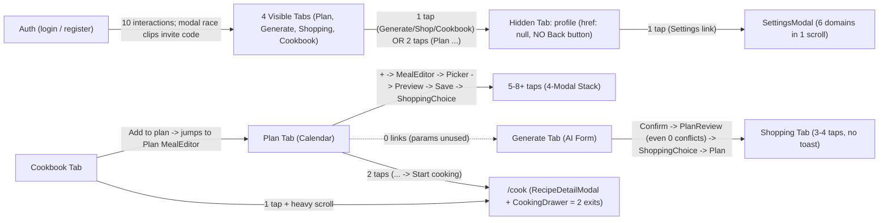

# MealWizard UI/UX & User Flow Audit Report

> [!NOTE]
> **Purely Investigative Audit**: Zero source files were modified during the audit (`git status` verified clean). Findings were produced by five independent flow investigators (`flow-account`, `flow-plan`, `flow-generate`, `flow-shopping`, `flow-cookbook`) and reconciled globally by `ux-architect`.

---

## 1. Executive Summary & Global UX Health Scorecard

MealWizard's underlying data engine (household sync, AI plan drafting, unit-normalized shopping grouping, offline check queuing, and step-aware cooking timers) is rich, but the **navigation shell and presentation layer** fragment user journeys across five divergent UI dialects, hidden routes, and deeply nested modals.

| UX Dimension | Rating | Core Diagnosis |
|---|---|---|
| **Navigation & Route Soundness** | **Needs Work** | `profile` is trapped inside `(tabs)` via `href: null` with no Back button; Plan hides Settings behind `...` unlike the other 3 tabs; `GenerateScreen` supports URL params (`date`, `mealType`, `preset`) that no screen links to; `/cook` double-wraps `CookingDrawer` inside `RecipeDetailModal`. |
| **Click & Tap Efficiency** | **Moderate → High Friction** | Routine tasks incur avoidable hops: email onboarding takes **10** in-app interactions; manual Plan meal add takes **5–8+** taps across 4 modal layers; Cookbook → custom Plan slot takes **5–6** taps and strands the user on Plan; clearing `N` purchased shopping items takes **`N+2`** taps; quick-add staples are hidden under `'Other'`. |
| **Visual Hierarchy & CTA Clarity** | **Mixed** | Primary CTAs are often buried (`Start cooking` sits below ingredients; `Forgot password?` sits outside `formCard` below Google Sign-In; `Swap ingredient` relies on an invisible `onLongPress`). Meanwhile, non-primary or admin elements (`AppInviteCard`, `Import a recipe` card, `36%`-wide shopping `recipePill`) steal primary focal space. |
| **Cognitive Load & Information Density** | **High Friction in Hubs** | `SettingsModal` stacks 6 domains (including 44 recipe-source controls and up to 40 nutrition inputs) in one ungrouped modal; `ClassicCalendar` squeezes household bars + nested scrollable meal list + unlabeled per-serving macros into one height-clamped card; `ShoppingScreen` truncates grocery titles against inline recipe pills. |
| **Design System Consistency & Polish** | **Fragmented** | Overlapping primitive kits ([classic.tsx](../components/connected/classic.tsx) vs. [ui.tsx](../components/connected/ui.tsx)); near-invisible light-mode borders (`#F5F5F4` on `#FFFFFF`); hardcoded light colors breaking dark mode; inconsistent decimal vs. fraction quantities; several sub-44×44px touch targets; and an unwired `DeveloperMode` switch. |

---

## 2. End-to-End Navigation & Click-Count Audit

### Current Cross-Flow Architecture & Friction Points

### End-to-End Click-Count Matrix (Current vs. Unified Target)

| User Journey | Current Taps / Interactions | Primary Root Bottleneck | Unified Target |
|---|---|---|---|
| **Email Sign-Up → Verified Household** | **10** (+email switch; +7 on mistyped invite code) | Forced sign-out before verification, blank login re-entry, post-verification invite validation, `RootNavigator` unmount race | **5–6** (stay signed in unverified + live code check + post-auth invite modal) |
| **Any Tab → `SettingsModal` (Exclusions / Reminders)** | **2** (other tabs) / **3** (Plan); **7–8** to change a reminder time | Plan lacks header gear icon; `/profile` intermediate hop; ungrouped 6-domain modal + 60-item minute scroller | **1** to Settings/Profile (**4–5** to edit reminder via direct deep-link) |
| **Empty Plan → AI Fill Gaps → Plan + Shopping** | **12–18+** | Zero Plan→Generate CTA; presets wipe Effort/Meals; `PlanReview` on 0 conflicts; `ShoppingChoice` modal; no Shopping toast | **4–5** (`Generate with AI` CTA → inline conflict toggle → `View Shopping` toast) |
| **Plan `+` → Add Saved Recipe** | **5–6** (Saved) / **6–8+** (Discover) | `MealEditor` wrapper + forced `RecipeDetailModal` preview + `ShoppingChoice` alert | **2–3** (direct `RecipePickerModal` with inline `Use` + silent `keep` sync) |
| **Cookbook → Schedule Custom Day/Slot** | **5–6** (+ strands user on Plan) | Routes to Plan tab `MealEditor` with `DateField` modal instead of inline quick-schedule | **3** (shared `QuickScheduleSheet`, stay on Cookbook, preserve servings) |
| **Cookbook URL Import → Save to Cookbook** | **4** (dismiss modal to tap card Save) | `RecipeDetailModal` omits `Save to cookbook` in `actionBar` when `!inCookbook` | **3** (`+ Import` sheet → Preview → `Save to cookbook` inside modal) |
| **Plan / Cookbook → Start Cooking → Finish & Mark Cooked** | **2–4** (+ heavy scroll + **2** exits + **2** mark-cooked) | Buried `Start cooking` CTA, `/cook` double-modal, `Done` skips mark-cooked | **1–2** (1-tap Cook / sticky CTA, standalone `/cook`, 1-tap `Done` + prompt) |
| **Shopping In-Store: Quick-Add / Offline Undo / Clear Purchased** | **4+scroll** / **Blocked** offline / **`N+2`** clear | Quick-add hidden behind `'Other'` default; pending queue locks row; no `Clear purchased` | **1** (top staples) / **1** (local undo) / **1–2** (`Clear purchased`) |

---

## 3. Step-by-Step Findings by Functional Area

### Area 1: Auth, Onboarding, Navigation Shell, Profile & Settings (`flow-account`)

#### Step-by-Step Flow Audit
1. **First-Time Registration & Household Creation/Joining** ([app/_layout.tsx](../app/_layout.tsx#L49-L57), [register.tsx](../app/register.tsx), [login.tsx](../app/login.tsx), [householdClient.ts](../services/householdClient.ts#L180-L340))
   - **Email/Password (10 in-app interactions)**: `LoginScreen` → `"Create Account"` (1) → Email, Password, Confirm Password (3 fields; no `returnKeyType`/`onSubmitEditing` focus chaining; eye icon at [register.tsx](../app/register.tsx#L192) is ~36×36px and absent on Confirm Password) + optional Invite Code (1) → `"Create Account"` (1) → `"Check Your Email"` Alert OK (1) → external email verification → re-enter Email & Password on blank `LoginScreen` (2) → `"Log In"` (1).
   - **Critical Onboarding Bugs**:
     - `passwordOnboarding.register` always signs out and throws `VERIFICATION_REQUIRED_CODE`, making `showInviteModal` in [register.tsx](../app/register.tsx#L79-L83) dead code.
     - Mistyped invite codes are not validated until post-verification login, triggering `ONBOARDING_RESUME_CODE` and a +7-interaction retry loop.
     - `RootNavigator` ([app/_layout.tsx](../app/_layout.tsx#L54-L56)) immediately redirects `user && householdId` to `/(tabs)`, unmounting `LoginScreen` before/while its `pendingInviteCode` Modal ([login.tsx](../app/login.tsx#L259-L290)) can be seen.
     - If `user && !householdId`, neither guard branch in `RootNavigator` matches, stranding the user on `/login` with no recovery UI.
   - **Google Sign-In (2 taps new household / 4 interactions to join)**: [AuthContext.tsx](../contexts/AuthContext.tsx#L287) throws `new Error('Google sign-in cancelled')` **without `.code`**, so `error.code !== 'ERR_REQUEST_CANCELED'` triggers a false `"Sign-In Failed"` alert on cancellation.

2. **Sign-In & Error Recovery** ([login.tsx](../app/login.tsx))
   - **Standard Login**: 3 interactions (Email + Password + `"Log In"`).
   - **Forgot Password**: Placed **outside** `formCard`, below the `"or"` divider and Google button ([login.tsx](../app/login.tsx#L214-L245)). If Email is empty, tapping it forces a blocking alert (`"Type your email address above..."`) requiring **4 taps + 1 field**.
   - **ErrorBoundary**: [app/_layout.tsx](../app/_layout.tsx#L26-L39) (styles at [L114-L119](../app/_layout.tsx#L114-L119)) provides 1-tap `"Try again"` (`minHeight: 48`) but hardcodes light colors (`#F2EAD3`, `#1F2A1F`, `#2F5D3A`).

3. **Reaching Profile & `SettingsModal` Across Tabs** ([app/(tabs)/_layout.tsx](../app/(tabs)/_layout.tsx#L95-L108), [profile.tsx](../app/(tabs)/profile.tsx#L97-L105))
   - `profile` uses `href: null` inside `(tabs)`, creating an orphaned tab state: the bottom tab bar remains visible with **zero active tabs**, and `ProfileScreen` has **no Back/Close button**.
   - Generate ([GenerationForm.tsx](../components/connected/GenerationForm.tsx#L133-L137)), Shopping ([ShoppingScreen.tsx](../components/connected/ShoppingScreen.tsx#L155)), and Cookbook ([CookbookScreen.tsx](../components/connected/CookbookScreen.tsx#L118)) offer a **1-tap** gear icon to `/profile`; Plan hides Settings inside `...` (`Calendar options`) → `"Settings"` (**2 taps** to `/profile`, **3 taps** to `SettingsModal`).
   - Deep-link captions (`GenerationForm` `"Edit household exclusions"`, `ClassicCalendar` `"Complete all nutrition target slots in Settings."`) either dump users onto `/profile` or aren't tappable at all.

4. **Household Preferences, Catalogue Settings & Meal Reminders** ([SettingsModal.tsx](../components/SettingsModal.tsx), [TimePickerModal.tsx](../components/TimePickerModal.tsx))
   - **Naming drift**: Gear says `"Settings"` / `"Household settings"` → Profile button says `"Household preferences and reminders"` ([profile.tsx](../app/(tabs)/profile.tsx#L102-L104), missing icon, chevron, and `Shadows.sm`) → Modal title says `"Generation Settings"`.
   - **Cognitive overload**: One flat `ScrollView` packs comma-separated `Household exclusions`, `Default Servings`, `4–40` inline `TargetInput` fields, all **11** `TRUSTED_SITES` (`Switch` + `1×/2×/3×` = **44** controls with ~32px `weightChip`s), chip-based `Kid-Friendly Custom Exclusions`, and `Meal Reminders` at the very bottom.
   - **TimePicker & Save hazards**: `TimePickerModal` `getItemLayout` length (`48`) mismatches `itemBtn` height (`44`), and lists 60 individual minutes. Closing `SettingsModal` (`X` / hardware back) **silently discards unsaved edits**. Also `onSaved={connected.retry}` re-runs all subscriptions unnecessarily, while saving reminder times does not trigger `useMealReminderSync` until plan confirmation/restart.

5. **Household Code & Switching Households** ([profile.tsx](../app/(tabs)/profile.tsx#L42-L80) & [L121-L180](../app/(tabs)/profile.tsx#L121-L180), [AppInviteCard.tsx](../components/AppInviteCard.tsx))
   - For admins, `<AppInviteCard />` sits above `"YOUR HOUSEHOLD CODE"`, burying household invites and conflating app-access invites with household member invites.
   - `"Switch"` ([profile.tsx](../app/(tabs)/profile.tsx#L168-L178)) uses full primary green (`colors.primary`) with no dimmed disabled opacity and **no confirmation dialog**, despite discarding the current meal plan and shopping list.

6. **Theme & Developer Mode** ([theme.ts](../constants/theme.ts#L35), [theme.ts](../constants/theme.ts#L64), [profile.tsx](../app/(tabs)/profile.tsx#L188-L233), [DeveloperModeContext.tsx](../contexts/DeveloperModeContext.tsx))
   - `Colors.light.border` (`#F5F5F4`) vs. `surface` (`#FFFFFF`) has ~1.08:1 contrast, making inputs, dividers, and chips nearly invisible in light mode.
   - **Dead feature**: `DeveloperMode` switch promises *"real-time execution logs during meal generation and shopping list confirmation"*, **but zero UI components read `developerMode` or `logs`**, while real `devLog` entries sit behind a 5-tap Easter egg on `"Harvest · v1.0.0"` in [SettingsModal.tsx](../components/SettingsModal.tsx#L552-L575).

---

### Area 2: Weekly Meal Plan, Calendar Navigation & Slot Management (`flow-plan`)

#### Step-by-Step Flow Audit
1. **Calendar Navigation & Nutrition Summary** ([PlanScreen.tsx](../components/connected/PlanScreen.tsx), [ClassicCalendar.tsx](../components/connected/ClassicCalendar.tsx#L129-L275) & [L395-L551](../components/connected/ClassicCalendar.tsx#L395-L551))
   - Defaults to Week view (`1 tap` Prev/Next; `1 tap` Week/Month toggle; `Today` is a hidden tap on unstyled date-range text or 2 taps via `...` → `"Today"`).
   - **State bugs**: `shift()` in Month view doesn't update `selectedDate`, so toggling back to Week can desync `selectedDate` from `days`; `MEAL_HISTORY_DAYS = 62` makes older months silently appear empty; notification `mealId` deep-links open `preview` without shifting the calendar to `m.date`.
   - **Visual & metric confusion**: Top of `dayCard` renders `"Daily goal · X adults · Y children"` progress bars using **household total** nutrition (even on empty days); bottom of `dayCard` renders 4 macro pills (`kcal`, `protein`, `carbs`, `fat`) using **per-serving** nutrition without any `"Per serving"` label. Meal-type badges reuse the same macro badge palette (`caloriesBadge`, `carbsBadge`, `proteinBadge`), and `dinner`, `side`, `snack`, `dessert`, and `component` all fall back to `🌙`.
   - **3-way nested scrolling**: `dayCard` clamps height (`Math.min(Math.max(300, height - 250), ...)`), nesting a vertical `ScrollView` inside a horizontal `FlatList` inside an outer `ScrollView`.

2. **Adding a Meal or Side via `RecipePickerModal`** ([PlanScreen.tsx](../components/connected/PlanScreen.tsx#L127-L242), [RecipePickerModal.tsx](../components/connected/RecipePickerModal.tsx))
   - **5–6 taps (Saved) / 6–8+ taps (Discover)**: `+` → `MealEditor` (`8` unprioritized fields above `"Save meal"`) → `"Choose recipe"` → `RecipePickerModal` → tap title (forced `RecipeDetailModal` preview, no inline select button) → `"Use recipe"` → `"Save meal"` → *(conditional)* `ShoppingChoice`.
   - Adding a side takes **6–9 taps** on existing meals (**8–11** when creating) and forces side servings to match main servings.

3. **Slot Actions (`RecipeActionsDrawer` vs. inline `menuMeal` Sheet)** ([PlanScreen.tsx](../components/connected/PlanScreen.tsx#L515-L591), [RecipeActionsDrawer.tsx](../components/connected/RecipeActionsDrawer.tsx))
   - **Naming & placement mismatch**: `RecipeActionsDrawer` only tracks `"Cooking history"` (`Mark cooked` + effort rating) and is hidden inside `RecipeDetailModal` `...`. Plan slot actions live in `PlanScreen`'s `menuMeal` sheet (`...` on meal row).
   - **Tap counts & gaps**:
     - *Start cooking*: **2 taps** (`...` → `"Start cooking"` → `/cook`), or **2 taps + long scroll** via card.
     - *View recipe*: **1 tap** on card, but missing from `menuMeal` (requires closing sheet). Attached `+ side` text on cards is un-tappable.
     - *Swap slots*: **3 taps** (`...` → `"Swap"`) or hidden 450ms long-press drag-and-drop (same week only). *Swap recipe*: **6–9 taps** via `MealEditor`.
     - *Change servings*: **3+ taps** via card scroll or **4 taps + typing** via `MealEditor`. Bug: [PlanScreen.tsx](../components/connected/PlanScreen.tsx#L319) (`normaliseMeal`) and [app/cook.tsx](../app/cook.tsx#L44-L49) strip `adults`/`children`, breaking half-serving (`0.5` child) scaling.
     - *Skip vs Remove*: `menuMeal` has `"Restore meal"` for skipped meals, but no `"Skip"` button (`"Remove"` deletes immediately with a persistent Undo banner).

4. **Empty Plan → AI Generation / Cookbook & Settings**
   - Zero in-canvas links from Plan to `/generate` or `/cookbook` (`calendarStyles.ts` empty styles are unused). Empty days steer users into manual `MealEditor`. Header says `"Calendar"` instead of `"Plan"` and lacks the `settings-outline` gear icon.

---

### Area 3: AI Meal Plan Generation, Plan Review & Substitutions (`flow-generate`)

#### Step-by-Step Flow Audit
1. **Configuring `GenerationForm`** ([GenerateScreen.tsx](../components/connected/GenerateScreen.tsx#L37-L109) & [L346-L362](../components/connected/GenerateScreen.tsx#L346-L362), [GenerationForm.tsx](../components/connected/GenerationForm.tsx))
   - Defaults (`5` days from next Monday, `dinner`, `30 min`, `summary=false`) allow **1–2 taps** quick generate, **but** a customized 7-day 3-meal plan takes **9–16+ interactions** across 9 stacked sections + `"Preferences"` sheet (`prefer` chips with case-sensitive match bug, `must`, extra `exclude`, `favourites`, misleading `"Plan leftovers"` toggle).
   - **Form friction**: Preset pills (`Tonight`, `5 dinners`, `Fill gaps`) **unconditionally reset** `types=["dinner"]` and `minutes=30`, wiping user edits; 5 backend cuisines (`greek`, `american`, `french`, `middle-eastern`, `global`) are missing from UI; `"Edit household exclusions"` ([GenerationForm.tsx](../components/connected/GenerationForm.tsx#L451-L458)) closes the sheet and navigates away to `/profile`. `GenerateScreen`'s `useLocalSearchParams` handling is completely unwired by other tabs.

2. **AI Generation & Loading Feedback** ([connectedGeneration.ts](../services/connectedGeneration.ts#L34-L320), [GenerateScreen.tsx](../components/connected/GenerateScreen.tsx#L426-L439))
   - **Critical UI Bug**: `createDraft` ([connectedGeneration.ts](../services/connectedGeneration.ts#L52-L53)) initializes every queued slot with `status: "failed"` and `message: "Ready to generate"`. `DraftRecipeCard` renders `slot.status`, causing **every waiting slot to display `"failed"`** until `fillDraft` reaches it!
   - `fillDraft` runs sequentially (`3N + 1` network round-trips for `N` slots) with no `"X of Y"` progress indicator or cancel-pending feedback. Promised `DeveloperMode` logs are absent.

3. **Reviewing Drafts (`PlanReview` & `DraftRecipeCard`)** ([GenerateScreen.tsx](../components/connected/GenerateScreen.tsx#L466-L703), [DraftRecipeCard.tsx](../components/connected/DraftRecipeCard.tsx), [PlanReview.tsx](../components/connected/PlanReview.tsx))
   - Ready cards offer `Keep`, `Swap` (**2 taps**, mutates card 3× sequentially and lists text-only replacements with no preview), and `Remove` — but **no 1-tap `Regenerate`** on ready slots, no servings/macros display, and `slot.reasons` are buried in `options`.
   - **Broken Servings & Missing Sides**: [GenerateScreen.tsx](../components/connected/GenerateScreen.tsx#L699-L703) opens `RecipeDetailModal` without `mealPlanEntry` or `defaultServings`, resetting servings to `recipe.originalServings ?? 2` and hiding `"Save Changes"`. `DraftSlot` lacks `sides`.
   - **Leftover allocation trap**: Changing slot time in `Meal preferences` forces `status: "failed"` and requires 3–4 taps; allocating leftovers disables `Swap` and hides options with **no UI to un-allocate**.

4. **Ingredient Substitutions (`SubstitutionDrawer`)** ([RecipeDetailModal.tsx](../components/RecipeDetailModal.tsx#L881), [SubstitutionDrawer.tsx](../components/connected/SubstitutionDrawer.tsx#L84-L115))
   - **Broken in Generate tab**: Triggered via hidden `onLongPress`, `SubstitutionDrawer` loads AI suggestions but hides Quantity/Unit/`"Apply to this meal"` when `meal` is `undefined` ([SubstitutionDrawer.tsx](../components/connected/SubstitutionDrawer.tsx#L100)) — silently dead-ending draft reviews. Even on Plan, `Quantity` starts blank (`""`) rather than pre-filled.

5. **Confirming Plan & Handoffs** ([GenerateScreen.tsx](../components/connected/GenerateScreen.tsx#L293-L295) & [L648-L660](../components/connected/GenerateScreen.tsx#L648-L660), [ConnectedContext.tsx](../contexts/ConnectedContext.tsx#L166-L176))
   - Dead `expectedRevision > 0` check; `PlanReview` opens unconditionally even when **0 slots conflict**; on Web, `ShoppingChoice` stacks over the open `PlanReview` `<Modal>`; confirming always routes to `/` (`Plan`) with **no CTA/toast to jump to Shopping** (**3–4 taps** from `Confirm meals` to Shopping).

---

### Area 4: Shopping List, Quick-Add & Check-Off Sync (`flow-shopping`)

#### Step-by-Step Flow Audit
1. **Generating, Reconciling & Date Filtering** ([ShoppingScreen.tsx](../components/connected/ShoppingScreen.tsx), [ConnectedContext.tsx](../contexts/ConnectedContext.tsx#L157-L182))
   - **Dead v4 code**: `services/shoppingDates.ts` (`TripPreset`) and client aggregation in `services/shoppingList.ts` are unused (`service.ts:638` enforces one ongoing household shopping list with a 14-day retention window).
   - **Lockout bug**: [ConnectedContext.tsx](../contexts/ConnectedContext.tsx#L164-L165) throws `"Wait for shopping changes to finish syncing before adding meals"` whenever `pendingRef.current.length > 0` — meaning offline check-offs block meal planning across the app.

2. **In-Store Browsing & Checking/Unchecking** ([ShoppingScreen.tsx](../components/connected/ShoppingScreen.tsx#L106-L167))
   - Fixed 12-aisle layout + bottom `PURCHASED` section; lacks aisle jump-bar, collapsible aisles, or search.
   - **Severe Offline/Undo Bug**: Checking an item (`1 tap`, `minHeight: 48`) immediately moves it to `PURCHASED`, while [ShoppingScreen.tsx](../components/connected/ShoppingScreen.tsx#L112) sets `disabled={locked || !!pending}` (and `ConnectedContext.tsx:492` throws on pending items). Any accidental tap while syncing — or during an entire offline grocery trip — **permanently locks the row in `PURCHASED` until back online**.
   - **Thumb-zone collision**: Right-aligned `recipePill` ([ShoppingScreen.tsx](../components/connected/ShoppingScreen.tsx#L123)) consumes **36% of card width**, truncating ingredient titles and causing frequent mis-taps into `RecipeDetailModal`.

3. **Adding Custom Items & `shoppingQuickAdd` Chips** ([ShoppingScreen.tsx](../components/connected/ShoppingScreen.tsx#L74-L94) & [L173-L185](../components/connected/ShoppingScreen.tsx#L173-L185), [shoppingQuickAdd.ts](../constants/shoppingQuickAdd.ts))
   - **Typed custom item (4–7 taps)**: Lacks `autoFocus` and `onSubmitEditing`; **`saveManual` sets `id: ''` ([ShoppingScreen.tsx](../components/connected/ShoppingScreen.tsx#L81)), so the inline `"Undo"` pill (`!!lastAdded.id`) NEVER renders for typed custom items!**
   - **Quick-Add discoverability trap (4 taps + scroll)**: Sheet defaults `category` to `'Other'`, which has **zero** entries in `QUICK_ADD_BY_CATEGORY`, hiding Quick-Add entirely until the user taps another aisle pill.

4. **Removing / Clearing Purchased / Resetting** ([ShoppingScreen.tsx](../components/connected/ShoppingScreen.tsx#L154) & [L169-L173](../components/connected/ShoppingScreen.tsx#L169-L173) & [L188](../components/connected/ShoppingScreen.tsx#L188))
   - **No `"Clear purchased"` action**: Clearing `N` purchased items takes **`N + 2` taps** (`Select` top-right → `N` individual taps → `Remove`), because `"All"` selects active + purchased items indiscriminately and triggers `"Remove"` with **zero confirmation dialog**.

5. **Source Attribution & Unit Formatting** ([ShoppingScreen.tsx](../components/connected/ShoppingScreen.tsx#L58-L69) & [L186-L195](../components/connected/ShoppingScreen.tsx#L186-L195))
   - `openRecipe` passes `defaultServings` **without `mealPlanEntry`**, hiding meal substitutions (`overrides`); detail sheet omits meal date/slot; `ShoppingScreen` uses decimals (`formatAmount`: `1.6 tbsp`) instead of `toFraction` (`⅓ cup`) used everywhere else; `item.notes`, `review`, `obsolete`, and `manual` flags are never surfaced.

---

### Area 5: Cookbook, Recipe Details & Active Cooking Mode (`flow-cookbook`)

#### Step-by-Step Flow Audit
1. **Cookbook Search, Filter & Schedule** ([CookbookScreen.tsx](../components/connected/CookbookScreen.tsx), [cookbookPresentation.ts](../services/cookbookPresentation.ts))
   - Header stacks search (`Field` lacks clear `X` button; ignores `notes`, `sourceUrl`, `description`), 2 filter rows (omits `component`, no tag/cuisine/sort controls, time filter hides recipes lacking duration), AND an always-expanded `Import a recipe` card (~240px) **above** all recipes.
   - `indexCookbook` silently drops recipes not yet batch-fetched, flashing an empty state during load.
   - **Cookbook → Plan (2–6 taps)**: Always pushes `/` (`PlanScreen`) into `MealEditor`, **dropping** any servings adjusted in `RecipeDetailModal` and stranding the user on the Plan tab.

2. **URL Import** ([CookbookScreen.tsx](../components/connected/CookbookScreen.tsx#L170-L209))
   - **4 taps**: Paste URL → `"Preview import"` → opens `RecipeDetailModal`, which **omits `"Save to cookbook"` in `actionBar`** when `!inCookbook` → user must close modal → tap `"Save to cookbook"` on the Import card below. Supported domains are unmentioned pre-submit.

3. **`RecipeDetailModal`** ([RecipeDetailModal.tsx](../components/RecipeDetailModal.tsx))
   - **Burying primary CTA**: `"Start cooking"` ([RecipeDetailModal.tsx](../components/RecipeDetailModal.tsx#L766)) sits below hero, tags, nutrition, times, servings stepper, equipment, and ALL ingredients (1–2+ screens of scroll).
   - **Touch/Accessibility & Missing Info**: `closeBtn` (`32×32`), `stepperBtn` (`36×36`), and label-edit pencil (`15px`) are sub-44×44; `recipe.description` and `CookbookEntry.notes` are never shown; static `Dimensions.get('window')` ignores resize/rotation; ingredient substitution has no visible cue.

4. **Active Cooking (`CookingDrawer`, `/cook`, Gestures)** ([CookingDrawer.tsx](../components/connected/CookingDrawer.tsx), [app/cook.tsx](../app/cook.tsx), [useBottomDrawerGesture.ts](../hooks/useBottomDrawerGesture.ts))
   - **Critical Active Timer Bug**: Step timers store `recipeId: id` ([CookingDrawer.tsx](../components/connected/CookingDrawer.tsx#L140)), while the persistent timer render filters `!t.recipeId` ([CookingDrawer.tsx](../components/connected/CookingDrawer.tsx#L325)) — **advancing to the next step makes running timers disappear!** `durationChoices` regex also misses `"min"`/`"hr"`/`"sec"` abbreviations.
   - **Modal Nesting & Double Exit**: `/cook` mounts `RecipeDetailModal` + `CookingDrawer` (`<Modal>` inside `<Modal>`, or 3–4 deep from `RecipePickerModal`). Tapping `"Done"` closes `CookingDrawer` back into `RecipeDetailModal` (**2 dismissals to exit**), doesn't reset step `0`, and doesn't prompt `"Mark cooked"`.
   - **Hands-Busy Ergonomics**: Step media (`180px`/16:9) sits above scaled `"Recipe quantities"`, pushing ingredients off-screen; `session.checked` is dead state; no full-ingredient toggle or side-dish switcher; `stepIngredients` single-word matching (`oil`, `pepper`) causes false positives; `useBottomDrawerGesture` (`onMoveShouldSetPanResponderCapture` + backdrop tap) risks accidental dismissal with wet hands or over embedded video.

---

## 4. Global UX Architect Reconciliation (`ux-architect`)

### Cross-Flow Decisions (Approved, Merged & Rejected)

| Topic | Reconciled Global Architecture |
|---|---|
| **Profile & Settings Navigation** | **Merge & Refine (Reject 5th Bottom Tab)**: Keep the bottom tab bar strictly to the 4 meal-workflow pillars (`Plan`, `Generate`, `Shopping`, `Cookbook`). Move `profile` out of `(tabs)` (`href: null`) into a root `<Stack>` screen `app/profile.tsx` with a Back button so tab state is preserved. Add the standard `settings-outline` `IconButton` to `ClassicCalendar.tsx` (`1 tap` across all 4 tabs) and support direct deep-linking to household preferences/exclusions from `GenerationForm` and `ClassicCalendar` without losing form state. |
| **`ShoppingChoice` & Bulk vs. Single Commits** | **Merge & Refine**: Single-meal additions (Plan, Quick-Schedule, Cookbook) silently **keep & merge** (zero blocking modal risk of wiping the weekly list for one dinner). For bulk commits (`PlanReview` / templates), replace the post-confirm `ShoppingChoice` modal/alert with an inline segmented toggle inside `PlanReview` (`"Shopping list: Add to existing (default) \| Replace list"`). Confirming lands on Plan with a 1-tap `"Plan saved · View Shopping →"` toast/banner. |
| **Cookbook ↔ Plan Scheduling & Discovery** | **Merge & Scope (Reject duplicating full Discover catalogue into Cookbook tab)**: Extract one shared `QuickScheduleSheet` (`Today` / `Tomorrow` / date + `mealType` + servings) so Cookbook `"Add to plan"` schedules in **2–3 taps without switching tabs**. On Plan, `+` opens `RecipePickerModal` directly (upgrading `"Saved"` with Cookbook search/filters + inline 1-tap `"Use"` buttons). Keep Cookbook focused on household recipes with a `"Discover recipes"` link to the shared picker, and add `"Save to cookbook"` inside `RecipeDetailModal` `actionBar` when `!inCookbook`. |
| **Cooking Route & Preview Mode Safety** | **Approve & Merge**: Decouple `/cook` (`app/cook.tsx`) into a standalone full-screen `CookingScreen` (eliminating double-modal exit, disabling accidental swipe/backdrop dismiss, pinning persistent timers in the header, moving scaled step ingredients above media, and prompting `"Mark cooked & rate effort"` on `"Done"`). Pin `"Start cooking"` on `RecipeDetailModal` when `mode !== 'preview'`, and suppress `"Start cooking"` / `"Mark cooked"` during `RecipePickerModal` or unconfirmed import previews. |
| **Unified `mealContext` & Substitutions** | **Approve & Standardize**: Pass unified `mealContext` (`adults`, `children`, `overrides`, `mode`) consistently across Plan, Shopping (`openRecipe`), Cook, Cookbook, and Generate drafts (adding `overrides`/editable servings to `DraftSlot` or gating cleanly). Add a visible `"Swap"` button on `IngredientCard` rows (keeping `onLongPress`) and pre-fill scaled `Quantity` in `SubstitutionDrawer`. |
| **Shopping Card & Store Mode** | **Approve**: Move `recipePill` below item metadata (eliminating the `36%` right thumb-zone mis-tap trap), allow local toggling/undo of queued offline checks, add `"Clear purchased"` (`1–2 taps` with confirmation), replace `'Other'`-hidden quick-add with a top staples strip + auto-categorization, and unify on `toFraction` (`utils/ingredientFormat.ts`). |
| **Generate Form, AI Status & Dev Mode** | **Approve**: Initialize `createDraft` slots with `status: "pending"` (not `"failed"`), preserve user `Effort`/`Meals` on preset taps, add 1-tap slot `"Regenerate"`, wire Plan empty-state CTAs to `/generate?preset=gaps`, and either wire `DeveloperModeContext.logs` into a collapsible generation/sync panel or remove the misleading toggle in `profile.tsx`. |

---

### Prioritized Global Roadmap

#### Tier 1 — Quick Wins (High-Impact Bug & Polish Fixes, Low Architectural Risk)
1. **Fix `createDraft` initial slot status** ([connectedGeneration.ts](../services/connectedGeneration.ts#L52-L53)): change `status: "failed"` → `"pending"` so queued cards do not render `"failed"`.
2. **Fix `CookingDrawer` timers** ([CookingDrawer.tsx](../components/connected/CookingDrawer.tsx#L140) & [L325](../components/connected/CookingDrawer.tsx#L325)): display running recipe timers persistently in the cooking header across steps and expand `durationChoices` regex (`min`/`hr`/`sec`).
3. **Fix light borders & dark-mode hardcoded colors** ([theme.ts](../constants/theme.ts#L35)): replace `#F5F5F4` border with visible contrast (e.g., `#E7E5E4`), and theme hardcoded colors in `PastelCard.tsx`, `GenerationForm.tsx`, `SettingsModal.tsx`, `profile.tsx`, and `app/_layout.tsx` (`ErrorBoundary`).
4. **Fix auth/account bugs**: pass `.code` on Google cancel ([AuthContext.tsx](../contexts/AuthContext.tsx#L287)), handle `user && !householdId` recovery in `RootNavigator`, move `"Forgot password?"` inside `formCard`, fix `TimePickerModal` `getItemLayout` height (`44` vs `48`), add confirmation + disabled styling to Household `Switch`, and wire or remove the dead `DeveloperMode` switch.
5. **Fix Shopping undo & shared formatting**: pass `id` into `setLastAdded` in `saveManual` ([ShoppingScreen.tsx](../components/connected/ShoppingScreen.tsx#L81)), default Quick-Add away from `'Other'`, unify on `toFraction`, and suppress `ShoppingCancelled` in `classic.tsx` `report`.
6. **Touch targets, typography & context parity**: resize sub-44px buttons (`register.tsx`, `RecipeDetailModal.tsx`, `SettingsModal.tsx`) to `>=44×44`; apply `Fonts.*` in `login.tsx` and `TabLayout`; pass `adults`/`children`/`overrides` consistently from `PlanScreen`, `ShoppingScreen`, `GenerateScreen`, and `app/cook.tsx`.

#### Tier 2 — Navigation & Click Reductions (Cross-Flow Structural Fixes)
1. **Unify Profile & Settings Routing**: Move `profile` to root `<Stack>` (`app/profile.tsx` with Back button), add `settings-outline` gear to `ClassicCalendar.tsx`, and support 1-tap deep-links to Preferences/Exclusions.
2. **Wire Plan ↔ Generate ↔ Shopping Loop**: Add Plan empty-state AI CTAs (`/generate?preset=gaps` / `?date=...`), skip `PlanReview` on zero conflicts, move bulk Shopping choice inline into `PlanReview` (silent `keep` for single-meal adds), add `"Plan saved · View Shopping →"` toast, and remove the `pendingRef.current.length` planning lockout.
3. **Streamline Scheduling & Shopping Store Mode**: Launch `RecipePickerModal` directly from Plan `+` (with inline 1-tap `"Use"`), share `QuickScheduleSheet` for Cookbook (staying on Cookbook), add `"Save to cookbook"` in `RecipeDetailModal` `actionBar`, allow offline check undo, and add `"Clear purchased"`.
4. **Decouple `/cook` from `RecipeDetailModal`**: Render standalone full-screen `CookingScreen` at `/cook` with completion prompt (`Mark cooked & rate effort`) and pinned `"Start cooking"` CTA when `mode !== 'preview'`.

#### Tier 3 — Information Hierarchy, Cognitive Load & Design System
1. **De-clutter Primary Screens**: Move Cookbook `"Import a recipe"` into a header `+ Import` modal (~240px reclaimed); separate `ClassicCalendar` household nutrition bars from labeled per-serving meal macros and remove 3-way nested scrolling; move `ShoppingScreen` `recipePill` below item metadata; move `AppInviteCard` to a bottom `"Admin"` section on Profile.
2. **Progressive Disclosure**: Group `SettingsModal` into 4 collapsible/tabbed sections; add a non-destructive quick-preset bar to `GenerationForm`; surface visible `"Swap"` buttons on ingredients (pre-filled quantity) and 1-tap `"Regenerate"` + rationale captions on `DraftRecipeCard`.
3. **Design System Consolidation**: Unify `classic.tsx` + `ui.tsx` + `Screen` (`SafeAreaView`, `maxWidth: 880`, consistent headers/fields) and adopt `useWindowDimensions` in `RecipeDetailModal.tsx`.
